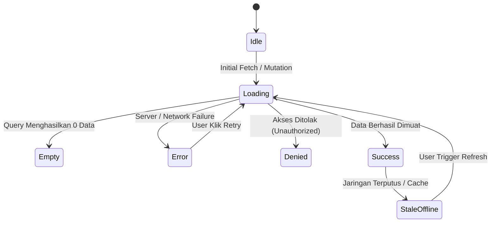

# Universal AI Master Orchestrator & Enterprise Engineering Team

<div align="center">

[](LICENSE)
[](agents/)
[](skills/)
[](skills/ui-ux-design-system/)
[](skills/frontend-quality/)
[](tests/)
[](adapters/)

**Transform your AI assistant into an autonomous, 32-role enterprise engineering council.**  
*Operates at the technical judgment standard of a Principal Software Engineer & Autonomous Technical Director with 25+ years of multidisciplinary software engineering experience.*

[Fitur Utama](#-fitur-utama--keunggulan) •
[Arsitektur SDLC](#-arsitektur--siklus-otonom-sdlc-10-tahap) •
[Anti-AI-Slop](#-standar-anti-ai-slop--desain-frontend-craft) •
[Daftar 32 Agen](#-direktori-32-specialist-agents) •
[Daftar 43 Skills](#-katalog-43-enterprise-skills) •
[Panduan Memulai](#-panduan-instalasi--penggunaan-cepat-quick-start) •
[CLI Otomasi](#-cli-command-center--manajemen-otomasi) •
[Multi-Platform](#-kompatibilitas-multi-platform-ide--cli)

---

</div>

> [!NOTE]
> **Project-Agnostic & Zero Vendor-Lock:** Sistem orkestrator ini bersifat sepenuhnya agnostik terhadap jenis proyek. Cukup konfigurasikan `PROJECT_CONTEXT.md`, dan seluruh 32 agen spesialis beserta 43 skill akan menyesuaikan nama sistem, arsitektur, database, dan aturan bisnis proyek Anda secara dinamis.

---

## 📖 Daftar Isi

1. [💡 Mengapa Membutuhkan Universal AI Master Orchestrator?](#-mengapa-membutuhkan-universal-ai-master-orchestrator)
2. [✨ Fitur Utama & Keunggulan](#-fitur-utama--keunggulan)
3. [🏛️ Arsitektur & Siklus Otonom SDLC 10-Tahap](#-arsitektur--siklus-otonom-sdlc-10-tahap)
4. [🎨 Standar Anti-AI-Slop & Desain Frontend Craft](#-standar-anti-ai-slop--desain-frontend-craft)
5. [👥 Direktori 32 Specialist Agents](#-direktori-32-specialist-agents)
6. [📚 Katalog 43 Enterprise Skills](#-katalog-43-enterprise-skills)
7. [🚀 Panduan Instalasi & Penggunaan Cepat (Quick Start)](#-panduan-instalasi--penggunaan-cepat-quick-start)
8. [🛠️ CLI Command Center & Manajemen Otomasi](#-cli-command-center--manajemen-otomasi)
9. [🌐 Kompatibilitas Multi-Platform (IDE & CLI)](#-kompatibilitas-multi-platform-ide--cli)
10. [🛡️ Tangga Verifikasi Bertingkat & Release Quality Gates](#-tangga-verifikasi-bertingkat--release-quality-gates)
11. [🔄 Contoh Alur Kerja Nyata (End-to-End Walkthrough)](#-contoh-alur-kerja-nyata-end-to-end-walkthrough)
12. [📂 Struktur Repositori](#-struktur-repositori)
13. [❓ Pertanyaan yang Sering Diajukan (FAQ)](#-pertanyaan-yang-sering-diajukan-faq)
14. [📄 Lisensi & Kontribusi](#-lisensi--kontribusi)

---

## 💡 Mengapa Membutuhkan Universal AI Master Orchestrator?

Kebanyakan asisten AI pengkodean modern bekerja seperti **bot autocomplete pasif**:
- ❌ **Hanya menguji nominal "Happy Path":** Mengabaikan error handling, negative path, permission denied, dan race condition.
- ❌ **Menghasilkan "AI Slop":** Desain UI generik dengan gradient ungu acak, emoji sebagai tombol, tata letak desktop menyempit (`max-w-4xl`), dan dark mode hitam pekat kasar.
- ❌ **Halusinasi & Mengubah Kontrak:** Menulis kode tanpa memvalidasi skema Zod, membiarkan IDOR, dan membocorkan stack trace teknis.
- ❌ **Menyatakan "Selesai" Tanpa Bukti:** Mengklaim fitur telah selesai hanya karena kode selesai ditulis tanpa verifikasi eksekusi terminal nyata.

**Universal AI Master Orchestrator** membalikkan paradigma tersebut menjadi **Autonomous Engineering Council**:

```
Tradisional AI Assistant                       Universal Master Orchestrator
┌─────────────────────────┐                   ┌──────────────────────────────────────────────┐
│  Pengguna Memberi Task  │                   │          Pengguna Memberi Outcome            │
└───────────┬─────────────┘                   └──────────────────────┬───────────────────────┘
            ▼                                                        ▼
┌─────────────────────────┐                   ┌──────────────────────────────────────────────┐
│ Autocomplete Kode Acak  │                   │ Phase 0: Ingest Memory & Living Heuristics   │
│ (Happy path saja,       │                   │ Phase 1: Critical Premise Evaluation & Scope │
│  tanpa validasi arsitek)│                   │ Phase 2: Dispatch 32 Spesialis & 43 Skills   │
└───────────┬─────────────┘                   │ Phase 3: Eksekusi Tangga Verifikasi T0 - T3  │
            ▼                                 │ Phase 4: Self-Healing Otomatis jika Gagal    │
┌─────────────────────────┐                   │ Phase 5: Distilasi Pembelajaran Permanen     │
│ Sering Regresi & Error  │                   │ Phase 6: Session Handoff & Governance Sign-Off│
└─────────────────────────┘                   └──────────────────────┬───────────────────────┘
                                                                     ▼
                                              ┌──────────────────────────────────────────────┐
                                              │ Hasil Produksi Teruji, Tervalidasi & Bersih  │
                                              └──────────────────────────────────────────────┘
```

---

## ✨ Fitur Utama & Keunggulan

### 1. 32 Peran Rekayasa Perangkat Lunak Spesialis
Mulai dari **Solution Architect**, **System Analyst**, **Principal Frontend/Backend**, **Database DBA**, **DevSecOps**, **Cybersecurity Analyst**, **Data Analyst**, **Data Scientist**, **FinOps**, **Statutory Privacy Reviewer**, hingga **QA Manual/Automation**—berkolaborasi layaknya dewan teknis senior.

### 2. Standar Desain Anti-AI-Slop & WCAG 2.2 AA
Menegakkan keindahan visual tingkat tinggi:
- **Obsidian/Slate Palette:** Token warna berlapis (`#0b0f19` canvas $\to$ `#111827` surface $\to$ `#161f33` elevated).
- **Universal 6-State Matrix:** Wajib menangani 6 state pada setiap view: *Loading (CLS = 0)*, *Empty*, *Error*, *Success*, *Denied*, dan *Stale/Offline*.
- **Aksesibilitas Universal:** Kontras $\ge 4.5:1$, fokus keyboard navigasi $\ge 3:1$, touch target minimum $44\times 44\text{px}$, dan kesiapan *Reduced Motion*.
- **Headless Component Composition:** Menerapkan pola Radix/shadcn compound primitives (`Root`, `Trigger`, `Content`, `Portal`, `Overlay`) untuk mencegah *monolithic div-soup*.

### 3. Ekosistem Skills & Playbook Terlengkap (43 Enterprise Skills)
Panduan rekayasa langkah demi langkah untuk arsitektur, basis data, keamanan, AI RAG, integrasi webhook, penanganan insiden, hingga pemulihan bencana (*Disaster Recovery & BCP*).

### 4. Single Source of Truth (SSOT) & Multi-Platform Compiler
Tulis sekali dalam standar Markdown murni, lalu jalankan `npm run sync`. Sistem otomatis menghasilkan adapter resmi untuk **Claude Code**, **Cursor**, **Windsurf**, **Cline/OpenCode**, **Aider**, **Continue.dev**, **OpenRouter**, dan **Google Antigravity**.

### 5. Tangga Verifikasi 4-Tingkat & Self-Healing Otonom
Kode tidak pernah dianggap selesai sebelum melewati tangga verifikasi bertingkat:
1. **Tier 0:** Static Hygiene & Compiler (`npm run lint`, `typecheck`).
2. **Tier 1:** Fast Air-Gapped Zero-DB Unit Tests ($<10\text{s}$).
3. **Tier 2:** Colocated Integration & Isolated Database Tests.
4. **Tier 3:** End-to-End User Journeys dengan Automated Axe Accessibility Scans.
Jika terjadi kegagalan, orkestrator melakukan siklus **Self-Healing otonom hingga 3 kali** sebelum meminta eskalasi manusia.

---

## 🏛️ Arsitektur & Siklus Otonom SDLC 10-Tahap

Master Orchestrator mengemudikan siklus rekayasa perangkat lunak perusahaan secara disiplin melewati 10 tahap formal:

```
[01 Discovery & Feasibility] ──► [02 Requirement Analysis] ──► [03 System & UX Design]
               │                                                              │
               ▼                                                              ▼
[06 SIT & Quality Validation] ◄── [05 Continuous Integration] ◄── [04 Development & Review]
               │
               ▼
[07 UAT & Approval] ──► [08 Deployment] ──► [09 Production Verification] ──► [10 Maintenance & Distillation]
```

### The 6-Phase Autonomous Loop

Pada setiap instruksi pengguna, orkestrator menjalankan 6 fase otonom berulang:

```mermaid
flowchart TD
    TaskIn[User Request / CR Goal] --> P0[Phase 0: Memory & Living Heuristic Ingestion]
    P0 --> P1[Phase 1: Critical Premise Evaluation & Blast Radius Triage]
    P1 --> P2[Phase 2: Autonomous Specialist Dispatch & Skill Activation]
    P2 --> P3[Phase 3: Automated Tiered Verification Ladder Execution]
    P3 --> GateCheck{Gates & Tests Pass?}
    GateCheck -->|Gagal / Ada Defect| P4[Phase 4: Autonomous Closed-Loop Self-Healing (Max 3 Retries)]
    P4 --> P3
    GateCheck -->|Lulus| P5[Phase 5: Continuous Learning & Living Memory Sync]
    P5 --> P6[Phase 6: Session Handoff & Governance Reporting]
```

---

## 🎨 Standar Anti-AI-Slop & Desain Frontend Craft

Orkestrator secara mutlak melarang pola desain murah yang umum dihasilkan AI generik:

```
❌ POLA AI-SLOP YANG DILARANG                    ✅ STANDAR CRAFT YANG DIWAJIBKAN
─────────────────────────────────────────────────────────────────────────────────────────────
• Ikon emoji untuk navigasi/kontrol (📁, ⚡, 🔍) • Sistem Ikon SVG Baku (Lucide, Radix, Heroicons)
• Glow blur neon acak (blur-3xl bg-purple-500)   • Kedalaman Berlapis & Obsidian Slate Palette
• Metrik analitik palsu / dummy filler data       • Data produk nyata yang terstruktur & bermakna
• Widescreen desktop sempit (max-w-4xl gutters)   • Fluid Responsive Grids (320px hingga 4K)
• Dark mode hitam pekat terbalik (#000000)        • Hierarki Slate Tonal (#0b0f19 -> #111827 -> #161f33)
• Hanya membuat state nominal (Happy path)        • Universal 6-State Component Matrix Lengkap
• Form tanpa label / vanishing placeholders       • Label permanen, aria-describedby, :user-invalid
• Tombol sentuh sempit / animasi pemicu vertigo  • Target sentuh ≥ 44x44px & prefers-reduced-motion
```

### Universal 6-State Component Matrix
Setiap komponen dan tampilan dinamis wajib mengimplementasikan seluruh matriks 6 state:



1. **Loading State (Layout Reservation):** Menggunakan skeleton pulse loader dengan dimensi geometri proporsional 1:1 untuk menjamin **Cumulative Layout Shift (CLS = 0)**.
2. **Empty State:** Edukasi onboarding yang informatif disertai tombol *Call-to-Action (CTA)* utama yang memandu pengguna membuat data pertamanya.
3. **Error State:** Pesan kegagalan yang manusiawi dan dapat ditindaklanjuti (bukan raw stack trace) disertai tombol *Retry*.
4. **Success State:** Konfirmasi visual yang elegan dengan pengumuman aksesibilitas live region (`aria-live="polite"`).
5. **Denied State:** Penjelasan izin akses tanpa membocorkan ID resource internal atau detail arsitektur rahasia.
6. **Stale / Offline State:** Penyajian data lokal ter-cache dengan indikator koneksi non-intrusif dan kemampuan sinkronisasi otomatis.

---

## 👥 Direktori 32 Specialist Agents

Berikut adalah katalog lengkap 32 peran spesialis yang siap digerakkan oleh **Universal Master Orchestrator**:

| # | Agent ID | Peran Spesialis | Hard Gates & Mandat Utama |
|---|---|---|---|
| 1 | **`orchestrator`** | Universal Chief Technical Director | Mengemudikan 10 tahap SDLC, matriks dispatch spesialis, tangga verifikasi, dan penyembuhan otomatis (*self-healing*). |
| 2 | **`solution-architect`** | Principal Solution Architect | Menjaga batas modul (`src/domains` vs `src/modules`), penulisan ADR, C4 model, dan evaluasi trade-off reversibilitas. |
| 3 | **`system-analyst`** | Lead System Analyst | Dekomposisi kebutuhan bisnis, state machine Mermaid, diagram sekuens, dan kontrak Zod sebelum koding dimulai. |
| 4 | **`product-manager`** | Principal Product Manager | Menentukan visi produk, aturan bisnis (`BR-*`), kriteria penerimaan Gherkin (Given/When/Then), dan Gate 1 (DoR). |
| 5 | **`frontend-engineer`** | Principal Frontend Engineer | Modern web UI, standar Anti-AI-Slop, batas Server/Client (RSC), CLS=0, form Zod, dan aksesibilitas WCAG 2.2 AA. |
| 6 | **`ux-engineer`** | Principal UX/UI Architect | Audit 10 Heuristik Nielsen, 4 Hukum Psikologi UX (Fitts, Hick, Miller, Jakob), tata letak fluida, dan microcopy. |
| 7 | **`backend-engineer`** | Principal Backend Engineer | REST route handlers, kontrak Zod, transaksi ACID, isolasi baris (`FOR UPDATE`), pertahanan IDOR, dan zero-leak errors. |
| 8 | **`fullstack-engineer`** | Principal Fullstack Engineer | Pengiriman vertical slice menyeluruh dari UI, route handlers, hingga migrasi schema database. |
| 9 | **`database-engineer`** | Principal Database Engineer | Schema PostgreSQL 16 & Drizzle ORM, migrasi zero-downtime expand/contract, indeks EXPLAIN, dan kaskade penghapusan. |
| 10 | **`data-engineer`** | Principal Data Engineer | Pipeline data ETL/ELT, analytical warehousing, event streams, idempotensi pemrosesan data, dan tata kelola privasi. |
| 11 | **`devops-engineer`** | Principal DevOps & SRE | Multi-tier environment, CI/CD pipeline, Docker, pemantauan canary, dan mitigasi downtime nol. |
| 12 | **`cloud-architect`** | Principal Cloud Architect | Topologi cloud multi-region (AWS/GCP/Azure), modularitas Terraform/IaC, zero-trust IAM, dan efisiensi egress. |
| 13 | **`secops-engineer`** | Principal DevSecOps Engineer | Otomasi SAST/DAST/SCA quality gates, pemodelan ancaman STRIDE, zero-leak secrets, dan triase kerentanan CVE. |
| 14 | **`security-engineer`** | Principal Security Engineer | Red-teaming aplikasi, pencegahan OWASP Top 10, integritas sesi & autentikasi, dan pertahanan prompt injection. |
| 15 | **`finops-engineer`** | Principal FinOps Engineer | Tata kelola unit economics cloud & AI, efisiensi prompt caching, token inference ceilings, dan eliminasi biaya tak terduga. |
| 16 | **`technical-writer`** | Staff Technical Writer | Kontrak OpenAPI 3.1, dokumentasi terstruktur kerangka Diátaxis, panduan pengembang, dan linting schema. |
| 17 | **`mlops-engineer`** | Staff MLOps & Vector Engineer | Pipeline embedding, infrastruktur vector database (pgvector/Qdrant), indeks HNSW, dan evaluasi recall benchmark. |
| 18 | **`compliance-auditor`**| Principal Compliance Auditor | Audit statutory enterprise: SOC 2 Type II, ISO 27001, PCI-DSS, audit log WORM tamper-evident, dan Separation of Duties. |
| 19 | **`privacy-reviewer`** | Regulatory Privacy Officer | Kepatuhan privasi data (GDPR / UU PDP / CCPA), inventarisasi PII, tata kelola persetujuan, dan penghapusan akun (<30s). |
| 20 | **`integration-engineer`**| Principal Integration Engineer | Integrasi antar sistem, keandalan webhook, OAuth 2.0, idempotency keys, dan retry exponential backoff dengan DLQ. |
| 21 | **`ai-engineer`** | Principal AI/LLM Engineer | Zero-Hallucination standard, pipeline provenance (VERIFIED/INFERRED/SUGGESTED), filtering $N_{out} \subseteq N_{in}$, dan mock AI. |
| 22 | **`mobile-engineer`** | Mobile Application Engineer | Aplikasi cross-platform (Flutter / React Native), offline-first sync, secure storage enclave, dan aksesibilitas mobile. |
| 23 | **`performance-engineer`**| Performance Engineer | Penegakan anggaran NFR (API P95 < 300ms, Core Web Vitals, export < 3s, $O(n)$ algorithmic checks) via k6 & Lighthouse. |
| 24 | **`qa-engineer`** | QA Automation Architect | Eksekusi STLC otomatis: Vitest unit/integration suites, Playwright E2E journeys dengan Axe scans, dan eliminasi flakiness. |
| 25 | **`qa-manual`** | Principal Exploratory Tester | Pengujian manual eksploratif SIT/UAT: Session-Based Test Management (SBTM), cross-browser (Firefox/Safari/Mobile), dan UAT. |
| 26 | **`test-architect`** | Enterprise Test Architect | Arsitektur piramida tes, fast-path T1 Air-Gapped Zero-DB unit test harness, dan pipeline data sintetis. |
| 27 | **`code-reviewer`** | Independent Code Reviewer | Adversarial review diff kode: mendeteksi regresi, inkonsistensi kontrak, dan memberi peringkat temuan (🔴 BLOCKING / 🟡 SHOULD FIX / 🔵 NIT). |
| 28 | **`quality-auditor`** | Enterprise Quality Auditor | Penjaga gerbang Release Quality Gates (Gates 1–8), validasi kebenaran bukti uji, RTM traceability, dan sertifikasi rilis. |
| 29 | **`release-manager`** | Release & Promotion Manager | Tata kelola promosi environment (Sandbox $\to$ UAT $\to$ Production), review CAB, dan protokol rollback deployment. |
| 30 | **`cybersecurity-analyst`** | Principal Cybersecurity Analyst | Adversary emulation (MITRE ATT&CK), audit pentest non-destruktif, verifikasi PoC celah keamanan, dan red-teaming sistem agen LLM. |
| 31 | **`data-analyst`** | Principal Data Analyst & BI Specialist | Menerjemahkan kebutuhan analitik ke query SQL tervalidasi, tata kelola metrik semantik, analisis EDA, visualisasi data anti-AI-slop. |
| 32 | **`data-scientist`** | Principal Data Scientist & ML Specialist | Desain pipeline statistical learning, rekayasa fitur zero-leakage, validasi silang (cross-validation), benchmark baseline, dan interpretabilitas SHAP. |

---

## 📚 Katalog 43 Enterprise Skills

Setiap skill merupakan buku pedoman rekayasa formal dengan standarisasi, pola kode, skrip bantuan, dan kriteria penerimaan yang terperinci:

```
KATEGORI SKILLS          DAFTAR SKILLS ENTERPRISE TERSEDIA
─────────────────────────────────────────────────────────────────────────────────────────────
🏗️ Arsitektur & SDLC     • sdlc-playbook          • architecture-decision
                         • requirement-analysis   • system-modeling
                         • change-request-gov     • technical-innovation
                         • api-doc-contract       • codebase-ast-map

🎨 Frontend & UI/UX      • ui-ux-design-system    • frontend-quality
                         • uiux-review            • mobile-quality

⚙️ Backend & Data         • api-design             • database-change
                         • system-integration     • observability-resilience
                         • nfr-governance         • event-driven-architecture
                         • zero-downtime-db       • exploratory-data-analysis

🤖 AI & Machine Learning • ai-feature             • continuous-learning
                         • rag-vector-engineering • ml-experimentation-lifecycle

🧪 Testing & Verifikasi  • offline-unit-harness   • qa-verification
                         • manual-testing         • defect-lifecycle
                         • system-debugging-rca   • performance-testing
                         • test-architecture-design

🔒 Keamanan & Regulasi   • security-review        • privacy-review
                         • threat-modeling        • code-review
                         • quality-audit          • penetration-testing-audit

☁️ DevOps & Cloud SRE    • ci-cd-deployment       • release-management
                         • implement-feature      • finops-cost-governance
                         • disaster-recovery-bcp  • incident-response
```

---

## 🚀 Panduan Instalasi & Penggunaan Cepat (Quick Start)

### 1. Kloning Repositori

Untuk mengklon repositori ke direktori kerja Anda:

```bash
# Klon ke direktori AI-MASTER-ORCHESTRATOR-DEVELOPMENT:
git clone https://github.com/adjiehf231/AI-MASTER-ORCHESTRATOR-DEVELOPMENT.git AI-MASTER-ORCHESTRATOR-DEVELOPMENT
cd AI-MASTER-ORCHESTRATOR-DEVELOPMENT

# Atau jika Anda sudah berada di dalam folder proyek tujuan:
git clone https://github.com/adjiehf231/AI-MASTER-ORCHESTRATOR-DEVELOPMENT.git .
```

Perintah satu baris untuk setup instan:
```bash
git clone https://github.com/adjiehf231/AI-MASTER-ORCHESTRATOR-DEVELOPMENT.git AI-MASTER-ORCHESTRATOR-DEVELOPMENT && cd AI-MASTER-ORCHESTRATOR-DEVELOPMENT && npm run sync && npm run verify:gates
```

### 2. Konfigurasi Profil Proyek Anda
Salin berkas template profil proyek:
```bash
cp PROJECT_CONTEXT.template.md PROJECT_CONTEXT.md
```
Buka `PROJECT_CONTEXT.md` dan definisikan parameter proyek Anda:
```markdown
# PROJECT CONTEXT CONFIGURATION

PROJECT_NAME: "MyEnterpriseApp"
PROJECT_ID: "MEA"
PRIMARY_LANGUAGE: "typescript"
FRAMEWORK: "nextjs-16"
DATABASE: "postgresql-16"
ORM: "drizzle"
SRC_DIR: "src"
DOCS_DIR: "docs"
```

### 3. Kompilasi Adapter Multi-Platform
Jalankan skrip sinkronisasi agar seluruh instruksi terkompilasi untuk IDE dan alat AI Anda:
```bash
npm run sync
```

### 4. Mulai Berpasangan (Pair-Programming)
Buka IDE Anda (Antigravity, Cursor, Windsurf, VS Code + Cline, atau Claude Code). Cukup sampaikan kebutuhan bisnis Anda:
> *"Terapkan fitur autentikasi dua faktor (2FA) lengkap dengan backup recovery codes dan verifikasi session."*

Orkestrator akan:
1. Membaca `docs/memory/` dan profil `PROJECT_CONTEXT.md`.
2. Mengevaluasi premis dan blast radius perubahan.
3. Mengaktifkan spesialis: `security-engineer` $\to$ `backend-engineer` $\to$ `frontend-engineer` $\to$ `qa-engineer`.
4. Mengimplementasikan kode dengan standar Anti-AI-Slop & Zod contracts.
5. Menjalankan tangga verifikasi (T0–T3) secara otomatis.

---

## 🛠️ CLI Command Center & Manajemen Otomasi

Kelola siklus hidup agen, skill, integrasi, dan audit langsung dari terminal Anda:

```bash
# ==============================================================================
# MANAJEMEN AGEN & SKILLS OTOMATIS
# ==============================================================================

# Membuat atau memperbarui Agen Spesialis baru dengan hard gates otomatis:
npm run agent:add -- <agent-name> --title="Principal Title" --desc="Deskripsi peran mandatori..."

# Membuat atau memperbarui Enterprise Skill playbook baru:
npm run skill:add -- <skill-name> --title="Skill Title" --desc="Panduan playbook..."

# Mengimpor agen atau skill dari repositori GitHub terpercaya atau berkas lokal:
npm run import:extension -- --type=agent --name=<name> --url="https://raw.githubusercontent.com/.../agent.md"
npm run import:extension -- --type=skill --name=<name> --file="./templates/skill.md"

# Menampilkan daftar seluruh 32 agen dan 43 skills terdaftar:
npm run orchestrator:list

# ==============================================================================
# SINKRONISASI & DEPLOYMENT
# ==============================================================================

# Kompilasi ulang seluruh adapter multi-platform (Claude, Cursor, Windsurf, OpenCode, dll):
npm run sync

# Kompilasi adapter dalam mode template murni:
npm run sync:template

# Deploy langsung ke live Google Antigravity & Gemini plugin directory:
npm run deploy:antigravity

# ==============================================================================
# VERIFIKASI KUALITAS & AUDIT INTEGRITAS
# ==============================================================================

# Menjalankan seluruh test suites unit dan integrasi (13 suites):
npm test

# Menjalankan fast-path T1 Air-Gapped Zero-DB Unit Test (<10 detik):
npm run test:t1

# Memeriksa penegakan Release Quality Gates (Gates 0, 1, 2):
npm run verify:gates

# Menjalankan audit menyeluruh Audit 360 (10/10 compliance checks):
npm run audit
```

---

## 🌐 Kompatibilitas Multi-Platform (IDE & CLI)

Universal AI Master Orchestrator dirancang dengan arsitektur **Single Source of Truth (SSOT)** yang dapat berjalan pada hampir seluruh ekosistem asisten AI modern:

| Platform / Alat AI | Berkas Adapter yang Digunakan | Cara Mengaktifkan |
|---|---|---|
| **Google Antigravity & Gemini** | `adapters/antigravity/plugin.json`, `rules/AGENTS.md` | Terinstal otomatis via `npm run deploy:antigravity`. |
| **Claude Code (CLI & Desktop)** | `CLAUDE.md`, `.claude/agents/*.md` | Terbaca otomatis saat membuka root project di terminal Claude. |
| **Cursor IDE** | `.cursorrules` | Terbaca otomatis oleh Cursor Agent di root workspace. |
| **Windsurf IDE (Codeium)** | `.windsurfrules` | Terbaca otomatis oleh Cascade AI. |
| **Cline / Roo-Code / OpenCode** | `.clinerules`, `.opencoderules`, `.opencode/agents/*.md` | Terdeteksi otomatis oleh ekstensi VS Code. |
| **Aider CLI** | `CONVENTIONS.md`, `.aider.conf.yml` | Terbaca otomatis saat menjalankan perintah `aider`. |
| **Continue.dev** | `.continue/rules/universal-orchestrator.md` | Terintegrasi ke sidebar Continue di VS Code / JetBrains. |
| **OpenRouter / 9router / LiteLLM** | `adapters/openrouter/system-prompt.txt`, `payload.json` | Salin teks system prompt ke dashboard gateway atau via REST API. |
| **ChatGPT / DeepSeek / Ollama** | `adapters/bundle/universal-system-prompt.md` | Bundel teks lengkap siap salin ke Custom Instructions / System Prompt. |

---

## 🛡️ Tangga Verifikasi Bertingkat & Release Quality Gates

Kode tidak pernah dinyatakan selesai hanya karena "tidak muncul error". Setiap fitur wajib melewati tangga verifikasi:

```bash
# Tier 0: Static Hygiene & Type Safety (<5s)
npm run lint          # 0 ESLint errors, 0 warnings
npm run typecheck     # 0 TypeScript compiler errors

# Tier 1: Fast-Path T1 Air-Gapped Zero-DB Unit Suites (<10s) ⚡
# Memvalidasi algoritma domain murni, provenance, dan aturan bisnis tanpa dependensi DB
node scripts/qa-unit-offline.cjs
# (atau: npm run test:t1)

# Tier 2: Colocated Unit & Isolated PostgreSQL Integration Suites (<2m)
npm test -- <path_to_suite>

# Tier 3: User-Facing E2E Journeys with Accessibility Audits (<5m)
npm run test:e2e      # Otomatisasi Playwright + @axe-core scans (0 violations)

# Tier 4: Database Schema Parity (jika schema disentuh)
npm run db:verify
```

> [!IMPORTANT]
> **Aturan Fail-Fast:** Jika pengujian Tier 1 (T1 Air-Gapped) gagal, orkestrator segera berhenti dalam $<10\text{s}$ dan memicu fase *Self-Healing*. Tidak akan ada container database atau browser E2E yang dijalankan jika algoritma inti belum lulus verifikasi!

---

## 🔄 Contoh Alur Kerja Nyata (End-to-End Walkthrough)

Berikut adalah simulasi bagaimana Master Orchestrator mengeksekusi instruksi pengguna:

1. **Pengguna Memberikan Permintaan:**
   > *"Buatkan halaman dashboard analitik kredit pengguna dengan data pemakaian bulanan dan riwayat transaksi."*

2. **Fase 0 & 1 (Ingesti Memori & Evaluasi Premis):**
   - Membaca `docs/memory/PROJECT_STATE.md` dan `HEURISTICS.md`.
   - Mengidentifikasi modul target di `src/modules/credits/`.
   - Menetapkan Change Request ID: `CR-CREDIT-2026-003`.

3. **Fase 2 (Dispatch Spesialis & Aktivasi Skills):**
   - `system-analyst` menyusun kontrak schema Zod untuk request dan response.
   - `backend-engineer` mengimplementasikan route handler dengan transaksi ACID atomik dan row locking `SELECT ... FOR UPDATE`.
   - `frontend-engineer` dan `ux-engineer` merancang tampilan dengan palet Obsidian/Slate, SVG Lucide icons, fluid layout, dan matriks 6 state lengkap (CLS = 0).

4. **Fase 3 & 4 (Eksekusi Tangga Verifikasi & Self-Healing):**
   - Menjalankan `npm run lint` dan `typecheck` $\to$ Lulus.
   - Menjalankan `npm test` $\to$ Terdeteksi error kecil pada mock assertion $\to$ *Self-Healing otomatis memperbaiki diff* $\to$ Re-run $\to$ Lulus.

5. **Fase 5 & 6 (Pembelajaran Permanen & Pelaporan):**
   - Menuliskan aturan heuristik baru ke `docs/memory/HEURISTICS.md`.
   - Menyajikan laporan Constitution §20 lengkap dengan bukti terminal dan status commit.

---

## 📂 Struktur Repositori

```
AI-MASTER-ORCHESTRATOR-DEVELOPMENT/
├── .github/                         # GitHub Actions CI/CD workflows
├── adapters/                        # Multi-platform adapters & bundles
│   ├── antigravity/                 # Google Antigravity & Gemini config (rules/AGENTS.md, plugin.json)
│   ├── opencode/                    # OpenCode V2 native adapter
│   ├── openrouter/                  # OpenRouter system prompt & request payload
│   └── bundle/                      # Universal prompt bundle (Codex, DeepSeek, Ollama)
├── agents/                          # 32 Specialist Agents Generalized (SSOT)
│   ├── orchestrator.md              # Master SDLC Director & Dispatch Matrix
│   ├── solution-architect.md        # Arsitektur sistem & ADR
│   ├── frontend-engineer.md         # Anti-AI-Slop, Accessible Frontend Architect
│   ├── backend-engineer.md          # Contract-first, ACID Backend Architect
│   ├── ux-engineer.md               # Nielsen heuristics, Cognitive UX Laws, a11y
│   └── ...                          # 27 agen spesialis lainnya
├── skills/                          # 43 Enterprise SDLC Skills (SSOT)
│   ├── ui-ux-design-system/         # Standar desain Anti-AI-slop, token & layout
│   ├── frontend-quality/            # 6-state matrix, zero CLS, WCAG 2.2 AA
│   ├── uiux-review/                 # 7-step evaluator walkthrough & cognitive probes
│   ├── api-design/                  # REST contracts, Zod, idempotency
│   ├── database-change/             # Migrasi PostgreSQL 16 & Drizzle ORM
│   ├── zero-downtime-database/      # Expand/Contract zero-downtime migrations
│   └── ...                          # 37 skills enterprise lainnya
├── scripts/                         # Automation CLI & synchronization scripts
│   ├── manage-orchestrator.js       # Lifecycle CLI untuk agen & skill
│   ├── import-extension.js          # Importer extension dari GitHub/lokal
│   ├── verify-gates.js              # Penegak Release Quality Gates (Gates 0-2)
│   ├── qa-unit-offline.cjs          # Fast-path T1 Air-Gapped Zero-DB runner
│   ├── audit-integrity.js           # Audit 360 integrity test suite (10/10)
│   ├── deploy-antigravity.js        # Deploy live ke plugin Antigravity
│   └── sync-adapters.js             # Multi-platform adapter compiler
├── tests/                           # 13 Automated test suites
├── docs/                            # 15 Dokumen Wajib Sistem & Living Memory
│   ├── memory/                      # PROJECT_STATE.md, DECISIONS.md, HEURISTICS.md
│   ├── process/                     # SDLC.md, STLC.md, CHANGE_MANAGEMENT.md
│   └── qa/                          # RELEASE_QUALITY_GATES.md, TEST_PYRAMID.md
├── CLAUDE.md                        # Native instruction file untuk Claude Code
├── .cursorrules                     # Native instruction file untuk Cursor IDE
├── .windsurfrules                   # Native instruction file untuk Windsurf IDE
├── .clinerules                      # Native instruction file untuk Cline & OpenCode
├── .opencoderules                   # Native instruction file untuk OpenCode
├── CONVENTIONS.md                   # Native instruction file untuk Aider CLI
├── PROJECT_CONTEXT.template.md      # Template konfigurasi profil proyek
├── PROJECT_CONTEXT.md               # Konfigurasi aktif proyek workspace
├── package.json                     # NPM lifecycle scripts & dependencies
├── LICENSE                          # MIT License
└── README.md                        # Dokumentasi resmi repositori
```

---

## ❓ Pertanyaan yang Sering Diajukan (FAQ)

### 1. Apakah orkestrator ini terikat pada framework atau bahasa pemrograman tertentu?
**Tidak.** Secara bawaan, orkestrator dirancang untuk TypeScript, Next.js, dan PostgreSQL, namun melalui `PROJECT_CONTEXT.md` Anda dapat mengonfigurasi proyek Python (FastAPI/Django), Go, Java (Spring Boot), Flutter, Rust, atau PHP. Semua agen dan skill beroperasi pada prinsip rekayasa agnostik.

### 2. Bagaimana cara mengimpor skill atau agen dari repositori luar?
Cukup gunakan perintah CLI:
```bash
npm run import:extension -- --type=skill --name=my-skill --url="https://raw.githubusercontent.com/.../SKILL.md"
```
Skrip otomatis memvalidasi struktur frontmatter, mengintegrasikannya ke registri, dan menyinkronkan seluruh adapter.

### 3. Apa yang dimaksud dengan pengujian T1 Air-Gapped?
Pengujian Tier 1 (`npm run test:t1`) adalah uji unit mandiri yang berjalan dalam isolasi total tanpa koneksi jaringan dan tanpa basis data nyata. Pengujian ini memastikan logika algoritma murni, validasi input Zod, dan perhitungan bisnis lulus dalam waktu $<10\text{ detik}$.

### 4. Apakah orkestrator melakukan deploy atau migrasi destruktif secara sepihak?
**Tidak.** Berdasarkan aturan *Statutory Safety Boundary*, orkestrator **secara mutlak dilarang** melakukan tindakan destruktif irreversible (seperti menjatuhkan database produksi, menghapus data pengguna, atau force-push ke branch utama) tanpa persetujuan eksplisit dari manusia.

---

## 📄 Lisensi & Kontribusi

Proyek ini dilisensikan di bawah lisensi terbuka [MIT License](LICENSE).  
Didedikasikan untuk komunitas rekayasa perangkat lunak global guna menghadirkan standar rekayasa kecerdasan buatan kelas enterprise yang disiplin, aman, dan berestetika tinggi.

<div align="center">

**Dikembangkan dengan standar rekayasa kelas Principal oleh Antigravity Engineering Council.**  
*Membangun masa depan rekayasa perangkat lunak otonom yang benar, teruji, dan indah.*

</div>
