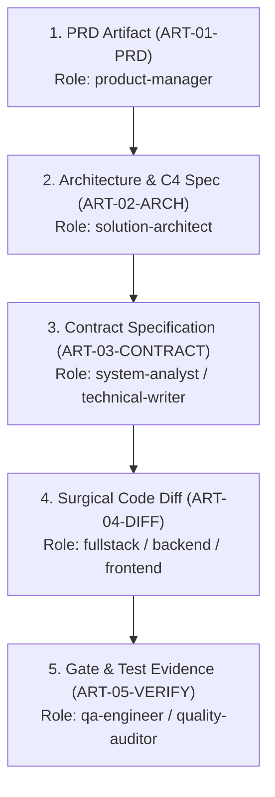

# Universal Enterprise SDLC Framework (Stages 01–10)

> **Authoritative Specification:** Governed by `skills/sdlc-playbook/SKILL.md`, `skills/change-request-governance/SKILL.md`, and Master Framework §1–§20.

---

## 1. The 10-Stage Enterprise SDLC Operating Map

```
[01 Discovery & Feasibility] ──► [02 Requirement Analysis] ──► [03 System & UX Design]
               │                                                              │
               ▼                                                              ▼
[06 SIT & Quality Validation] ◄── [05 Continuous Integration] ◄── [04 Development & Review]
               │
               ▼
[07 UAT & Approval] ──► [08 Deployment] ──► [09 Production Verification] ──► [10 Maintenance & Distillation]
```

---

## 2. Stage Governance, Artifacts & Hard Exit Gates

| # | Stage Name | Accountable Lead | Support Council | Primary Skills | Key Artifacts | Mandatory Exit Gate |
|---|---|---|---|---|---|---|
| **01** | **Discovery & Feasibility** | `product-manager` | `solution-architect`, `system-analyst` | `requirement-analysis`, `technical-innovation` | Feasibility Memo, Scope Hypothesis, Initial Risk Register | Feasibility approved, zero-cost-first validated. |
| **02** | **Requirement Analysis** | `product-manager` | `system-analyst`, `privacy-reviewer` | `requirement-analysis`, `change-request-governance` | BRD, User Stories (INVEST), `BR-${PROJECT_ID}-*` rules | **Gate 1 (DoR):** Immutable BR IDs, Given/When/Then ACs, data minimization verified. |
| **03** | **System & UX Design** | `solution-architect` | `system-analyst`, `ux-engineer`, `database-engineer`, `security-engineer` | `system-modeling`, `architecture-decision`, `ui-ux-design-system`, `uiux-review` | SRS, ADRs (`docs/architecture/`), OpenAPI/Zod Contracts, ERD & Data Dictionary, Wireframes | Contract interfaces locked, state machines defined, NFR budgets set. |
| **04** | **Development & Peer Review** | `fullstack-engineer` (or specialist: `frontend`, `backend`, `mobile`, `ai`, `data`) | `code-reviewer` | `implement-feature`, `frontend-quality`, `offline-unit-harness`, `code-review` | Source code in `${SRC_DIR}/`, Colocated unit tests, Code Review Findings | **Gate 2 (DoD):** 0 lint/compiler errors, T1 fast-path pass ($<10\text{s}$), 0 blocking review findings. |
| **05** | **Continuous Integration** | `devops-engineer` | `test-architect` | `ci-cd-deployment`, `offline-unit-harness` | `.github/workflows/ci.yml`, CI build artifacts | **Gate 0:** Gitleaks secret scan clean, T1 unit pass, db:migrate verified. |
| **06** | **SIT & Quality Validation** | `qa-engineer` (Auto) + `qa-manual` (Exploratory) | `security-engineer`, `performance-engineer` | `qa-verification`, `defect-lifecycle`, `security-review`, `performance-testing` | Test Plans (`TC-${PROJECT_ID}-*`), Defect Log, SIT Execution Report, k6 load reports | **Gate 4 (SIT) & Gate 6 (Hardening):** 0 open S1/S2 defects, 100% Zero-Hallucination score, IDOR clean. |
| **07** | **UAT & Business Approval** | `release-manager` | `qa-manual`, Human Product Owner | `release-management`, `change-request-governance` | UAT Execution Log, Human PO Sign-off Certificate | **Gate 5 (UAT):** Sanitized production mirror passes all scenarios; formal sign-off archived. |
| **08** | **Deployment & Promotion** | `release-manager` | `devops-engineer`, `database-engineer` | `release-management`, `ci-cd-deployment`, `database-change` | Deployment Runbook, Release Candidate Tag, Migration Rollback Plan | **Gate 7 (RC):** Golden path E2E green on release tag, migration parity verified. |
| **09** | **Production Verification** | `release-manager` | `qa-manual`, `devops-engineer` | `observability-resilience`, `manual-testing` | Smoke Test Logs ($<30\text{s}$), Live APM Telemetry, Release Notes | **Gate 8 (Production):** Zero-downtime deploy verified, smoke tests green, error budget healthy. |
| **10** | **Maintenance & Distillation** | `orchestrator` | All Specialist Leads | `continuous-learning`, `change-request-governance` | Post-Mortem RCA, `docs/memory/HEURISTICS.md`, `ANTI_PATTERNS.md`, `TECHNICAL_DEBT.md` | Mandatory 4-step reflection distilled; living memory synchronized. |

---

## 3. The 15 Mandatory Enterprise System Documents (Framework §15)

Every major system capability must maintain and synchronize the 15 mandatory artifacts across its lifecycle:

```
 1. Business Requirements Document (BRD)       ──► docs/product/
 2. System Requirements Specification (SRS)     ──► docs/product/SRS/
 3. Functional & Non-Functional (NFR) Specs     ──► docs/design/NFR/
 4. Architecture Document & Boundary Maps       ──► docs/architecture/
 5. ERD & Data Dictionary                       ──► docs/data/DATA_DICTIONARY.md
 6. API Contracts (Zod / OpenAPI)               ──► docs/api/ & src/modules/*/contracts
 7. UI/UX Design, Flow & Design System          ──► docs/design/ & src/components/
 8. Test Plan & Test Cases (TC-*)               ──► docs/qa/ & tests/
 9. Defect & Open Ticket Log                    ──► docs/qa/DEFECT_MANAGEMENT.md
10. Change Request (CR) Register                ──► docs/process/CR_REGISTER.md
11. SIT & UAT Execution Reports                 ──► docs/reports/
12. Deployment & Rollback Plan                  ──► docs/delivery/DEPLOYMENT_RUNBOOK.md
13. Release Notes & Changelog                   ──► docs/memory/CHANGELOG.md
14. Runbook & Operational SOP                   ──► docs/operations/RUNBOOK.md
15. ADR & Technical Debt Register               ──► docs/architecture/ADR-* & docs/memory/TECHNICAL_DEBT.md
```

---

## 4. End-to-End Traceability Matrix Invariant

Traceability is bidirectional and mandatory:
$$\text{User Story} \iff \text{BR-\$\{PROJECT\_ID\}-*} \iff \text{ADR-*} \iff \text{Code Module} \iff \text{TC-\$\{PROJECT\_ID\}-*} \iff \text{CI Log}$$

If a code change cannot be traced back to an approved `BR-${PROJECT_ID}-*` and forward to an executed `TC-${PROJECT_ID}-*`, it constitutes unauthorized scope drift and is rejected at Gate 2.

---

## 5. Formal Multi-Agent Artifact Pipeline Flow (MetaGPT & OpenHands Standard)

To prevent prompt distortion and context degradation across multi-agent handoffs, all specialist agents communicate through structured artifact deliverables:



### Mandatory Artifact Metadata Standard:
Each artifact handoff must include:
- `artifact_id`: Deterministic ID format: `ART-<PHASE>-${PROJECT_ID}-<NNN>`.
- `author_role`: The creating specialist agent.
- `upstream_artifact`: Direct link to parent artifact (ensuring 100% provenance chain).
- `invariants_validated`: Explicit assertion of preserved core invariants.
- `downstream_role`: Designated consumer specialist role.
