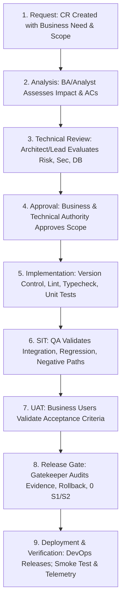

# Change Request Governance & Technical Debt Management — ${PROJECT_NAME}

Authoritative sources: Master Framework (§15, §17, §18, §20), `docs/process/CHANGE_MANAGEMENT.md`, `docs/process/RELEASE_GOVERNANCE.md`, and the Enterprise Engineering Constitution.

In an enterprise software ecosystem, undocumented changes, uncontrolled scope creep, and untracked technical debt lead to system decay and production outages. **Every change must be traceable, reviewed, verified, approved, and auditable.**

---

## 1. The 9-Stage Change Request (CR) Lifecycle



---

## 2. The 8 Inviolable Change Control Rules (Framework §17)

1. **Unique Identification:** Every CR carries an immutable identifier: `CR-${PROJECT_ID}-<YEAR>-<NNN>`.
2. **Traceability Chain:** Every CR links directly:
   $$\text{Business Rule / BRD} \iff \text{CR-ID} \iff \text{Git Branch / Commit} \iff \text{Test Cases (TC-*)} \iff \text{Verification Logs}$$
3. **Formal Scope Impact Analysis:** Scope adjustments must document blast radius across the 22 modules, database schemas, and external integrations before work begins.
4. **Zero Open S1/S2 Defects at Gate:** Critical defects (`S1`) or Major defects (`S2`) block release. No gate bypass without formal, signed Human Executive dispensation based on quantifiable business risk.
5. **Database Migration Safety & Rollback:** Schema changes must include proven down-migrations or tested rollback runbooks.
6. **Production Verification & Rollback Plan:** Every deployment plan must specify smoke test verification steps ($< 30\text{s}$) and automatic rollback triggers.
7. **Independence of Gates:** Business UAT sign-off does NOT replace technical code review, database review, or security approval.
8. **Disambiguated State Transitions:**
   - **`READY_FOR_TEST`:** Code merged to target branch, static checks clean, deployed to test tier.
   - **`PASSED_SIT`:** QA automated and manual integration test suites green.
   - **`APPROVED_UAT`:** Business Owner has reviewed test evidence and confirmed acceptance.
   - **`RELEASE_APPROVED`:** All statutory quality gates (1–8) audited and certified.
   - **`DEPLOYED`:** Running in production and verified by live smoke tests.

---

## 3. The 15 Mandatory Enterprise System Documents Checklist (Framework §15)

Every major capability or release cycle must ensure the following 15 artifacts are authored, maintained, and synchronized:

| # | Mandatory Document / Artifact | Canonical Repository Location | Primary Responsible Role |
|---|---|---|---|
| **1** | **Business Requirements Document (BRD)** | `docs/product/` | `product-manager` / `business-analyst` |
| **2** | **System Requirements Specification (SRS)** | `docs/product/SRS/` | `system-analyst` |
| **3** | **Functional & Non-Functional (NFR) Specs** | `docs/design/NFR/` | `system-analyst` / `solution-architect` |
| **4** | **Architecture Document & Boundary Map** | `docs/architecture/` | `solution-architect` |
| **5** | **ERD & Data Dictionary** | `docs/data/DATA_DICTIONARY.md` | `database-engineer` / `data-engineer` |
| **6** | **API Contracts (Zod / OpenAPI)** | `docs/api/` / `src/modules/*/contracts` | `backend-engineer` / `system-analyst` |
| **7** | **UI/UX Design, Flow & Design System** | `docs/design/` / `src/components/` | `ux-engineer` / `frontend-engineer` |
| **8** | **Test Plan & Test Cases (`TC-*`)** | `docs/qa/` / `tests/` | `test-architect` / `qa-engineer` |
| **9** | **Defect / Open Ticket Log** | `docs/qa/DEFECT_MANAGEMENT.md` | `qa-manual` / `qa-engineer` |
| **10** | **Change Request (CR) Register** | `docs/process/CR_REGISTER.md` | `release-manager` / `orchestrator` |
| **11** | **SIT & UAT Execution Reports** | `docs/reports/` | `qa-engineer` / `release-manager` |
| **12** | **Deployment & Rollback Plan** | `docs/delivery/DEPLOYMENT_RUNBOOK.md` | `devops-engineer` / `release-manager` |
| **13** | **Release Notes & Changelog** | `docs/memory/CHANGELOG.md` | `release-manager` |
| **14** | **Runbook & Operational SOP** | `docs/operations/RUNBOOK.md` | `devops-engineer` / `sre-engineer` |
| **15** | **ADR & Technical Debt Register** | `docs/architecture/ADR-*`, `docs/memory/TECHNICAL_DEBT.md` | `solution-architect` / `orchestrator` |

---

## 4. Technical Debt Management Protocol

Technical debt is an active risk that incurs compound interest. Every deferred refactoring or architectural compromise must be registered:

### Technical Debt Schema (`docs/memory/TECHNICAL_DEBT.md`):
```markdown
### [DEBT-KAR-<NNN>] <Descriptive Title>
- **Date Incurred:** [YYYY-MM-DD]
- **Affected Module / Subsystem:** `src/modules/...`
- **Why It Was Incurred:** [Temporary deadline, dependency limitation]
- **Technical Risk & Impact:** [Performance degradation, maintenance overhead, security surface]
- **Cost of Remediation:** [Estimated engineer-days]
- **Target Liquidation Sprint:** [Milestone / Sprint ID]
- **Owner:** [Lead Engineer]
```

### Debt Review Governance:
- The `orchestrator` and `solution-architect` review the Technical Debt Register at the start of every release cycle.
- Allocate at least $15\%$ of sprint capacity to technical debt liquidation to prevent structural decay.

