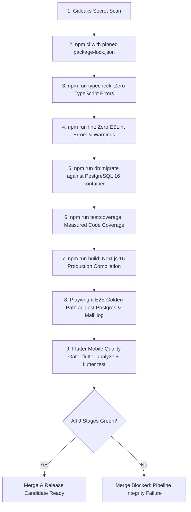

# CI/CD Pipeline & Environment Operations — ${PROJECT_NAME}

Authoritative sources: `.github/workflows/ci.yml`, `docker-compose.yml`, `scripts/start-environment.ts`, `scripts/sync-uat-from-prod.ts`, `scripts/verify-all-environments.ts`, `.gitleaks.toml`, `docs/operations/`, and `docs/delivery/`.

The delivery pipeline is the statutory guardian of production stability. An automated pipeline that can be bypassed or that permits failing stages to be ignored is not an engineering control. Every release to production must traverse an unbroken chain of verified quality gates.

---

## 1. The Statutory Quality Gate Pipeline (`.github/workflows/ci.yml`)

The CI pipeline runs automatically on pull requests and pushes to `main`:

### Invariant:
A red or skipped stage strictly prohibits merging or deployment. Pipeline stages may not be disabled or relaxed to force a release through.

---

## 2. Multi-Tier Environment Topology & Ports

PostgreSQL 16 runs in Docker (`init-multiple-dbs.sh`), hosting five strictly isolated database tiers:

| Tier Name | Database Identifier | Environment | Data Profile | Integration Mode |
|---|---|---|---|---|
| **Development** | `${DB_NAME}_dev` | Local workspace | Ad-hoc local test records | Mock third parties |
| **Test / CI** | `${DB_NAME}_test` | Automated runner | Transactional rollback fixtures | In-memory mocks, zero network |
| **Sandbox (SIT)**| `${DB_NAME}_sit` | Sandbox testing | Synthetic multi-personas (`seed:sit`) | Mock AI, MailHog (`:1025/:8025`) |
| **Pre-Prod (UAT)**| `${DB_NAME}_uat` | Business acceptance | 1:1 Sanitized production mirror | Sandbox credentials, real quotas |
| **Production** | `${DB_NAME}_prod` | Live SaaS | Live encrypted customer data | Live production gateways |

---

## 3. Pre-Production UAT Data Sanitization Standard

Per Statutory Data Privacy (GDPR / UU PDP / CCPA per project profile), raw production customer data must **NEVER** flow into lower environments:
1. When synchronizing data from production to UAT via `npm run sync:uat`:
   - Replace real candidate names with deterministic synthetic names (`Kandidat UAT 001`).
   - Replace real emails with `@uat.${PROJECT_DOMAIN}` test addresses.
   - Replace real phone numbers with `+6281200000XXX`.
   - Wipe all password hashes and reset them to a standard UAT test password.
2. Verify sanitization integrity before opening UAT to stakeholders.

---

## 4. Secrets & Cryptographic Hygiene

1. **Gitleaks Pre-Push & CI:**
   - Scan runs automatically via `.gitleaks.toml`.
   - Never commit `.env`, `.env.production`, or private certificates.
2. **Environment Variable Parity:**
   - `.env.example` must document all required variables with placeholder values.
   - CI placeholder secrets (e.g. `SESSION_SECRET` for build verification) must never be used in operational tiers. Production secrets must have minimum 256-bit entropy.

---

## 5. Release Deployment Protocols (Gates 7 & 8)

### Gate 7: Release Candidate (RC) Verification
- CI Quality Gate pipeline passes 100% on the target release branch.
- Database migration parity verified: `npm run db:verify` confirms parity matching the 12 canonical migrations baseline.
- Automated rollback rehearsal executed in Sandbox/SIT.

### Gate 8: Production Launch Execution
1. **Zero-Downtime Rollout:** Blue/Green container swap ensuring ongoing HTTP requests complete before old containers are terminated.
2. **Automated Production Smoke Test:**
   - Trigger automated smoke suite immediately post-traffic switch.
   - **Must complete in $< 30\text{s}$**.
   - Walk Golden Path: Health probe $\to$ Authentication check $\to$ Master profile read.
3. **Canary Telemetry Active:**
   - Error budget: HTTP 5xx $< 0.1\%$ over first 60 minutes.
   - Latency budget: API P95 $< 300\text{ms}$.

---

## 6. Automated Rollback Runbook

### Rollback Trigger Thresholds:
- Smoke test failure or execution duration $> 30\text{s}$.
- HTTP 5xx error rate $> 0.5\%$ over a 5-minute rolling window.
- Unhandled database deadlock or connection pool saturation.

### Step-by-Step Rollback Execution:
1. **Revert Traffic:** Instantly route reverse proxy traffic back to the previous stable blue container.
2. **Database Reversion (if migration was applied):**
   - If additive (expand phase): leave new columns in place (previous code is forward-compatible).
   - If contract phase: execute pre-tested down-migration script.
3. **Incident Freeze:** Open incident log in `docs/operations/INCIDENT_LOG.md` and alert stakeholders.

---

## Output Contract

STATUS: DONE / PARTIAL / BLOCKED
- **PIPELINE GATE RESULTS:** Execution logs and run IDs per CI stage.
- **ENVIRONMENT HEALTH AUDIT:** Verification output of `npm run verify:tiers`.
- **MIGRATION PARITY STATUS:** Output of `npm run db:verify`.
- **SMOKE SUITE VERIFICATION:** Measured production smoke duration (<30s).
- **ROLLBACK PLAN STATUS:** Verified down-migration and container rollback readiness.
- **NEXT ACTIONS:** Release manager sign-off or incident remediation.
