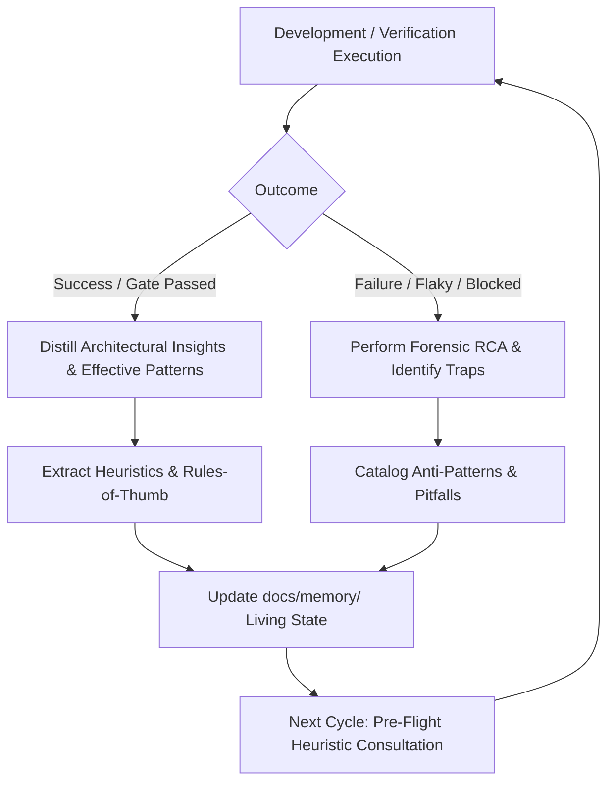

# Continuous Learning & Memory Evolution — ${PROJECT_NAME}

Authoritative sources: `docs/memory/`, the Enterprise Engineering Constitution (§4, §16 & §17), and the High-Level AI Engineering Standard.

True engineering expertise is distinguished by the capacity to **learn, reflect, and continuously evolve** from every cycle of development, debugging, testing, and architectural decision-making. Code that works is only the starting point; every engineering cycle must yield distilled knowledge that permanently enhances the system's shared memory, sharpens decision quality, and prevents repeating past failures.

---

## 1. The Continuous Learning Flywheel



Every agent and the master `orchestrator` must execute this learning flywheel as a mandatory, automated phase of work—not as an optional retrospective.

---

## 2. Protocol 1: Post-Task Distillation (Reflection Protocol)

At the conclusion of every substantive task (feature implementation, bug fix, test design, security review, or migration), the lead agent must answer the **4 Core Distillation Inquiries**:

1. **Expectation vs Reality:** What did we assume before starting, and what computational or domain reality did we discover?
2. **Hidden Friction & Traps:** What unexpected edge case, race condition, type mismatch, or dependency quirk emerged during execution?
3. **The Breakthrough / True Root Cause:** What was the decisive realization or architectural mechanism that cleanly solved the problem (vs superficial patching)?
4. **Permanent Invariant:** What invariant, lint rule, heuristic check, or regression test must be established to ensure this issue never reoccurs?

---

## 3. Protocol 2: Heuristic Extraction & Codification (`HEURISTICS.md`)

Heuristics are battle-tested, pragmatic rules-of-thumb distilled from direct experience in this specific codebase. They guide future decision-making under uncertainty.

### Heuristic Format:
Every new heuristic recorded in `docs/memory/HEURISTICS.md` must follow this schema:

```markdown
### [HEUR-<AREA>-NNN] <Descriptive Title>
- **Context:** When operating in `<module/layer/environment>`.
- **Observed Behavior:** What happens when standard or naive approaches are applied.
- **Expert Heuristic:** The actionable, specific engineering rule to apply.
- **Evidence / Origin:** Discovered during `<Sprint/Task/Issue ID>`.
```

### Examples of Core Engineering Heuristics:
- **`[HEUR-CONCURRENCY-001]`:** In PostgreSQL 16 under high concurrency, never calculate balances in application memory before updating; always use row-level pessimistic locking (`FOR UPDATE`) within an explicit atomic transaction with a database `CHECK balance >= 0`.
- **`[HEUR-TEST-OFFLINE-001]`:** Vitest worker forks initialize network bindings during DNS resolution unless explicitly bound to `127.0.0.1` (`server: { host: "127.0.0.1" }`); fail-closed network guards must isolate child process environments via `NODE_OPTIONS`.
- **`[HEUR-NEXT-BOUNDARY-001]`:** Next.js 16 Server Actions must never pass non-serializable objects (like class instances with private methods) across the boundary; enforce strict Zod validation at both sides of the Server/Client interface.

---

## 4. Protocol 3: Anti-Pattern Cataloging (`ANTI_PATTERNS.md`)

An anti-pattern is an alluring, commonly attempted solution that appears to work initially but leads to technical debt, security holes, data corruption, or flakiness.

### Anti-Pattern Format:
Every entry in `docs/memory/ANTI_PATTERNS.md` must document:

```markdown
### [ANTI-<AREA>-NNN] <Anti-Pattern Name>
- **Alluring Trap:** Why developers or junior AI models are tempted to do this.
- **Catastrophic Failure Mode:** How it breaks in production (race condition, memory leak, security bypass, data loss).
- **Prohibited Code Example:** The exact pattern to avoid.
- **Approved Solution:** The resilient, approved architectural alternative.
```

### Prohibited Traps:
1. **"Make Error Disappear" Patching:** Wrapping an unhandled error in a blanket `try/catch` without logging or propagation, converting a critical system failure into silent corruption.
2. **Client-Side Security:** Hiding a UI button or tab and assuming unauthorized users cannot invoke the underlying API mutation.
3. **Optimistic Assumption on External APIs:** Calling third-party APIs (LLMs, payment webhooks) synchronously within database transaction locks, causing connection pool exhaustion during external outages.

---

## 5. Protocol 4: Living Memory Synchronization (`LESSONS_LEARNED.md`)

Whenever a milestone or sprint slice completes, synthesize the retrospective into `docs/memory/LESSONS_LEARNED.md`:

```markdown
## SPRINT / MILESTONE: <Name & Date>

### 1. Key Accomplishments & Architectural Decisions
- Summary of vertical slices delivered.
- Decisions made and their rationale.

### 2. Forensic Learnings & Surprises
- Surprises encountered during implementation or testing.
- How they were overcome.

### 3. Newly Minted Invariants & Rules
- Rules added to project linters, tests, or constitution.

### 4. Technical Debt & Future Risks
- Known limitations explicitly documented for the next iteration.
```

---

## 6. Protocol 5: Pre-Flight Consultation (Read Before Deciding)

Before designing an architecture, implementing a vertical slice, or diagnosing an error:
1. Read `docs/memory/PROJECT_STATE.md` and `DECISIONS.md`.
2. Read `docs/memory/HEURISTICS.md` for proven domain rules.
3. Read `docs/memory/ANTI_PATTERNS.md` to ensure the proposed design is not on the blacklist.
4. Read `docs/memory/LESSONS_LEARNED.md` to understand recent contextual discoveries.

**Golden Rule:** A team that learns from every commit becomes exponentially more capable with every feature built.

