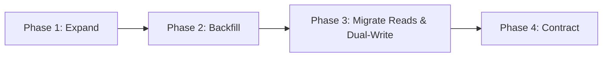

# Database Change & Migration Engineering — ${PROJECT_NAME} (PostgreSQL 16 + Drizzle)

Authoritative sources: `drizzle.config.ts`, `drizzle/`, `src/infrastructure/database/`, `docs/data/`, and the Enterprise Engineering Constitution (§9 & §18).

Database migrations permanently alter persistent production state. A flawed migration causes table locks, application downtime, data corruption, or irreversible data loss. This skill provides the formal engineering methodology to evolve schemas safely, deterministically, and with zero downtime.

---

## 1. Statutory Invariants of Database Engineering

1. **Inspect Before Design:** Read existing schema models in `src/infrastructure/database/schema/` and versioned migration files in `drizzle/` before drafting any change. Guessing column names or historical constraints is prohibited.
2. **Review Generated SQL Line by Line:** Generated DDL from `npm run db:generate` must be inspected line by line before execution. Any unpredicted `DROP` or destructive `ALTER` requires an immediate stop and schema redesign.
3. **Explicit Approval for Destructive DDL:** `DROP TABLE`, `DROP COLUMN`, `TRUNCATE`, type narrowing, or adding un-defaulted `NOT NULL` columns to populated tables requires explicit written human approval and a tested rollback plan (Constitution §18).
4. **Zero-Downtime Expand/Contract Staging:** Destructive changes or column renames must be executed in staged phases across separate releases. Direct renames on populated tables are forbidden.
5. **Erasure Cascade Parity (Statutory Data Privacy (GDPR / UU PDP / CCPA per project profile)):** Any new table containing user career or personal data must be integrated into the transactional account erasure cascade (`DELETE /api/v1/user/account` completing in $< 30\text{s}$). Missing integration is an S1 Critical Defect.
6. **No `db:push` Against Shared Tiers:** Never execute `drizzle-kit push` against shared, SIT, UAT, or Production databases. Enforced via `scripts/guard-db-push.ts`.
7. **Query Plan Evidence for Indexes:** Every new index must be justified by an exact query and before/after `EXPLAIN (ANALYZE, BUFFERS)` evidence demonstrating sequential scan elimination.

---

## 2. The Expand $\to$ Backfill $\to$ Migrate Reads $\to$ Contract Lifecycle

To evolve schemas without locking tables or breaking running application instances during rolling deployments:



### Phase 1: Expand (Release N)
- Add the new column or table as `nullable` or with a default value.
- Existing application code continues writing and reading the old shape without disruption.

### Phase 2: Backfill (Background Operation)
- Populate the new column from historical data in bounded transactional batches:
  ```sql
  -- Bounded batch backfill pattern
  UPDATE cv_sections
  SET structured_data = jsonb_build_object('raw', legacy_content)
  WHERE id IN (
    SELECT id FROM cv_sections
    WHERE structured_data IS NULL
    LIMIT 5000
  );
  ```
- Pause between batches to release row locks and prevent replication lag.

### Phase 3: Migrate Reads & Dual-Write (Release N+1)
- Deploy updated application code that writes to both old and new columns, and switches reads to the new column.
- Monitor canary health and error rates.

### Phase 4: Contract (Release N+2)
- Remove read/write dependencies on the old column from the codebase.
- Safely drop the deprecated column via a final migration.

---

## 3. Query Performance & Indexing Evidence Standard

Indexes speed up reads but penalize every `INSERT`, `UPDATE`, and `DELETE`. An index must be proven necessary with execution evidence:

### 3.1 Composite Index Column Ordering
Arrange composite index columns following query filter mechanics:
1. **Equality Columns First:** Columns filtered with exact equality (`WHERE tenant_id = ? AND user_id = ?`).
2. **Range / Sort Columns Second:** Columns filtered by range or sorting (`AND created_at >= ? ORDER BY created_at DESC`).

### 3.2 Partial Indexes for Sparse Statuses
When queries filter on a subset of status values, index only those rows:
```sql
CREATE INDEX idx_job_applications_pending 
ON job_applications (job_id, created_at DESC) 
WHERE status = 'PENDING_REVIEW';
```

### 3.3 EXPLAIN Evidence Format
Document index justification in the delivery report:
```text
Query: SELECT * FROM cvs WHERE user_id = $1 ORDER BY updated_at DESC LIMIT 10;
Row Count: 250,000 rows

BEFORE INDEX:
Seq Scan on cvs  (cost=0.00..8450.20 rows=10 width=512) (actual time=45.120..48.310 rows=10 loops=1)
Buffers: shared hit=421 read=3820

AFTER INDEX (CREATE INDEX idx_cvs_user_updated ON cvs (user_id, updated_at DESC)):
Index Scan using idx_cvs_user_updated on cvs  (cost=0.42..8.45 rows=10 width=512) (actual time=0.045..0.062 rows=10 loops=1)
Buffers: shared hit=4 read=0
Execution Time: 0.085 ms (99.8% reduction in latency)
```

---

## 4. Financial & Credit Ledger Integrity Standards

- **Atomic Transactions:** Wrap credit debit, ledger append, and business mutations in a single transaction.
- **Pessimistic Row Locking:** Prevent concurrent double-spends using `SELECT ... FOR UPDATE`.
- **Database-Level Non-Negative Constraint:**
  ```typescript
  export const userCredits = pgTable('user_credits', {
    id: uuid('id').defaultRandom().primaryKey(),
    userId: uuid('user_id').references(() => users.id, { onDelete: 'cascade' }).notNull().unique(),
    balance: integer('balance').notNull().default(0),
    updatedAt: timestamp('updated_at', { withTimezone: true }).defaultNow().notNull(),
  }, (table) => [
    check('chk_balance_non_negative', sql`${table.balance} >= 0`),
  ]);
  ```

---

## 5. Account Erasure Cascade Standard (`DELETE /api/v1/user/account`)

Verify that the deletion cascade covers all user entities within the $< 30\text{s}$ SLA:
```typescript
// Transactional cascade erasure order
await db.transaction(async (tx) => {
  // 1. Delete dependent leaf records
  await tx.delete(atsReports).where(eq(atsReports.userId, targetUserId));
  await tx.delete(jobMatches).where(eq(jobMatches.userId, targetUserId));
  await tx.delete(cvSections).where(eq(cvSections.userId, targetUserId));
  await tx.delete(cvs).where(eq(cvs.userId, targetUserId));
  await tx.delete(careerItems).where(eq(careerItems.userId, targetUserId));
  await tx.delete(careerProfiles).where(eq(careerProfiles.userId, targetUserId));
  await tx.delete(creditLedgers).where(eq(creditLedgers.userId, targetUserId));
  await tx.delete(userCredits).where(eq(userCredits.userId, targetUserId));
  await tx.delete(userConsents).where(eq(userConsents.userId, targetUserId));
  // 2. Delete root user identity
  await tx.delete(users).where(eq(users.id, targetUserId));
});
```

---

## 6. Multi-Tier Verification Protocol

Execute migration validation across environments:
1. Generate migration: `npm run db:generate`.
2. Inspect the generated DDL in `drizzle/` line by line.
3. Apply to local test database: `npm run db:migrate`.
4. Verify migration parity: `npm run db:verify` (confirm all 12 canonical migrations baseline + new migration).
5. Run TypeScript compiler: `npm run typecheck`.
6. Run full automated test suite: `npm test`.

---

## Output Contract

STATUS: DONE / PARTIAL / BLOCKED
- **DDL SUMMARY:** Full SQL text generated in `drizzle/`.
- **MIGRATION ARTIFACTS:** Paths to created migration files.
- **STAGING PLAN:** Expand, backfill, and contract timeline.
- **EXPLAIN PLAN EVIDENCE:** Verbatim query plans before and after.
- **ROLLBACK DDL & RUNBOOK:** Step-by-step down-migration commands.
- **TIER VERIFICATION RESULT:** Output of `npm run db:verify`.
- **NEXT ACTIONS:** Backend repository updates or delivery handoff.
