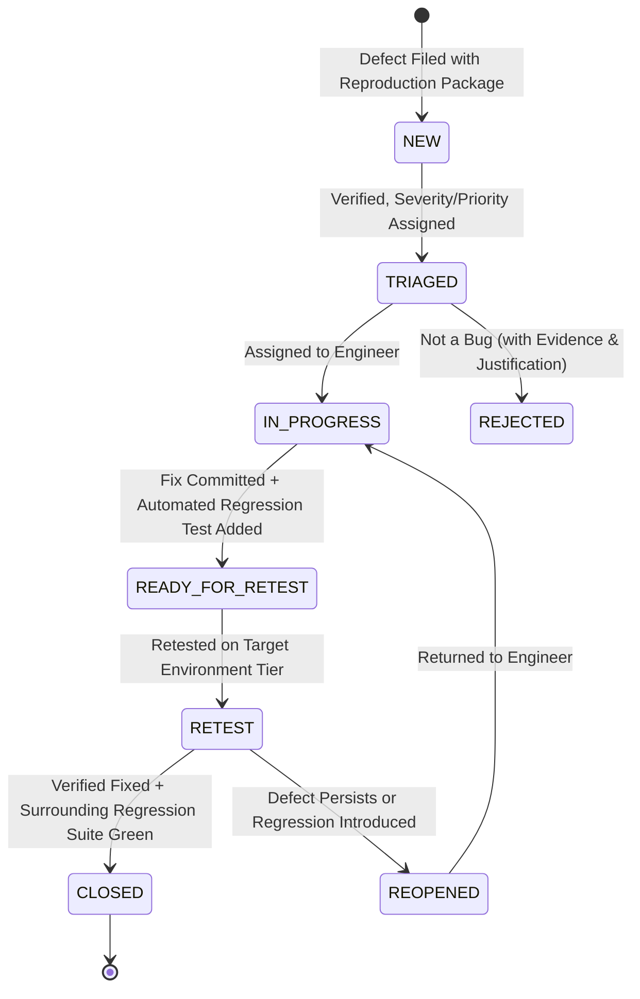

# Defect Lifecycle & Root Cause Analysis — ${PROJECT_NAME}

Authoritative sources: `docs/qa/DEFECT_MANAGEMENT.md`, `docs/qa/REGRESSION_STRATEGY.md`, and the ${PROJECT_NAME} Constitution (§13 & §14).

A defect is a learning opportunity and a quality signal. Poor defect reports waste engineering time; premature defect closures cause production regressions.

---

## 1. Severity vs Priority Decoupling Matrix

Never confuse technical impact (Severity) with business urgency (Priority):

```
+-----------------------------------------------------------------------------------+
| SEVERITY (Technical & System Impact)                                              |
+-----------------------------------------------------------------------------------+
| S1 - CRITICAL: Data corruption, cross-user IDOR, hallucinated fact persisted,     |
|      account erasure failure, credit double-spend, total system crash.             |
| S2 - HIGH: Major feature inoperable with no workaround, PDF export 500 error,     |
|      NFR latency breach (>100% SLA), credit overspend under concurrency.          |
| S3 - MEDIUM: Degraded functionality with viable workaround, localized UI glitch,  |
|      minor copy inconsistency in non-critical flow.                                |
| S4 - LOW: Cosmetic defect, typo, minor spacing/alignment imperfection.            |
+-----------------------------------------------------------------------------------+
| PRIORITY (Execution Urgency)                                                      |
+-----------------------------------------------------------------------------------+
| P0 - IMMEDIATE BLOCKER: Must be resolved immediately; blocks build, PR, or deploy. |
| P1 - HIGH URGENCY: Must be resolved in current sprint / release candidate.        |
| P2 - NORMAL / LOW: Backlog item for scheduled resolution.                         |
+-----------------------------------------------------------------------------------+
```

### Invariant:
Gate 6 and Production Release strictly forbid ANY open S1 or S2 defects, regardless of priority. Downgrading severity to force a release past a gate is a serious governance violation.

---

## 2. Defect State Machine



---

## 3. Defect Report Anatomy (Reproduction Package)

An unreproducible defect report is a defective report. Every report must contain:

1. **Defect Title:** Concise, descriptive summary format: `[Domain/Module] Failure summary when action taken under condition`.
2. **Metadata:** Unique ID (`DEF-NNN`), Severity (`S1–S4`), Priority (`P0–P2`), Environment Tier (Local / SIT / UAT / Prod), Build SHA.
3. **Preconditions:** Required user persona, initial database state, credit balance, seeded data fixtures.
4. **Step-by-Step Reproduction:** Numbered, unambiguous sequence of actions.
5. **Observed vs Expected Result:**
   - **Observed:** Verbatim error code, unexpected UI state, crash log.
   - **Expected:** Expected business behavior per requirement specification.
6. **Evidence Attachment:** Verbatim terminal log, HTTP request/response payload, browser console log, MailHog email capture, or Playwright trace.

---

## 4. Root Cause Analysis (5-Whys RCA)

For all S1 and S2 defects, conduct a 5-Whys RCA to identify systemic root causes:

- *Problem:* A jobseeker was charged double credits during CV tailoring.
- *Why 1:* Two concurrent requests both read balance = 1 and both passed deduction check.
- *Why 2:* The deduction logic checked balance in memory before writing to the database.
- *Why 3:* There was no row-level database lock or atomic transaction boundary wrapping the check and debit.
- *Why 4:* The developer relied on client-side button disable to prevent double clicks.
- *Why 5:* Architecture guidelines did not enforce atomic database-level constraints for ledger mutations.
- *Root Cause Fix:* Implement database-level row lock (`FOR UPDATE`) and CHECK constraint `balance >= 0`.

---

## 5. Mandatory Regression Test Binding (Constitution §13)

A bug fix is INCOMPLETE without a permanent automated regression test:
1. **Red Test First:** Write a test that reproduces the defect and fails on the current codebase.
2. **Apply Fix:** Implement the smallest clean fix.
3. **Green Test:** Verify the test now passes.
4. **Permanent Suite Inclusion:** Colocate the regression test in the appropriate test suite (`src/**/*.test.ts`, `tests/api/`, or `tests/e2e/`).

---

## 6. Closure Protocol & Verification Standard

A defect may only be closed when:
- [ ] Fix is verified on the target tier where the defect was discovered.
- [ ] Automated regression test is executed green in CI.
- [ ] Surrounding regression test set for the affected domain (`docs/qa/REGRESSION_STRATEGY.md`) passes 100%.
- [ ] Evidence of retest (terminal logs, screenshots) is attached to the defect report.

---

## Output Contract

STATUS: FILED / TRIAGED / RESOLVED / CLOSED / REOPENED
- **DEFECT ID & TITLE:** Formal defect identifier and summary.
- **SEVERITY & PRIORITY:** S1–S4 and P0–P2 classification.
- **ROOT CAUSE ANALYSIS:** 5-Whys summary.
- **REGRESSION TEST COMMITTED:** Path to permanent regression test case.
- **VERIFICATION EVIDENCE:** Command output demonstrating fix and clean retest.
