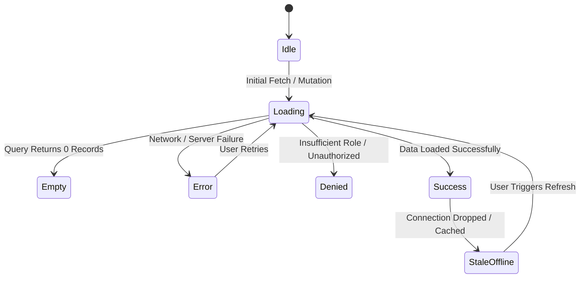

# Frontend Quality & UI Architecture — Enterprise Standards

Authoritative sources: `skills/ui-ux-design-system/`, `${DOCS_DIR}/ui/`, `docs/qa/ACCESSIBILITY_TEST_STRATEGY.md`, and the Enterprise Engineering Constitution.

Frontend engineering is not merely making a page render; it is delivering an accessible, resilient, lightning-fast, and universally inclusive digital experience across all devices and network conditions without succumbing to low-craft, generic "AI slop".

---

## 1. The Anti-AI-Slop & Craft Standard

All user interfaces must be engineered with intentional visual craft, semantic tokens, and high-quality design principles:

### 1.1 Prohibited AI-Slop Tropes
- ❌ **No Emoji UI Icons:** Never use emojis (`📁`, `🚀`, `⚡`, `🔍`, `💼`) for UI controls, navigation, or status badges. Always use curated SVG icons (Lucide, Radix, Heroicons).
- ❌ **No Arbitrary Neon Glows:** Eliminate decorative background blur blobs (`blur-3xl bg-purple-500/20`) unless part of an approved brand identity.
- ❌ **No Fake/Decorative Dashboards:** Every metric, card, and chart must represent structured product data, never fake filler statistics.
- ❌ **No Boxed-In Desktop Views:** Do not confine desktop views to rigid `max-w-4xl` or `max-w-5xl` when viewed on widescreen displays (1440px–4K), leaving massive empty gutters.
- ❌ **No Inverted Black-and-White Dark Mode:** Dark mode requires layered obsidian and slate tonal hierarchy, not raw #000000 cards.

### 1.2 Mandatory Craft Principles
- ✅ **Layered Design Tokens:** Dark mode uses Obsidian Slate (`#0b0f19` canvas, `#111827` surface, `#161f33` elevated); Light mode uses Clean Slate (`#f8fafc` canvas, `#ffffff` surface).
- ✅ **Fluid Responsive Grids:** Seamless scaling from 320px mobile to 4K ultra-wide screens.
- ✅ **Tactile Micro-Interactions:** 150ms–200ms ease-out transitions, tactile button active states (`active:scale-[0.98]`), accessible focus rings.
- ✅ **Semantic HTML & WCAG 2.2 AA:** Meaningful landmark tags, full keyboard operability, contrast $\ge 4.5:1$ text and $\ge 3:1$ controls.

---

## 2. Server vs Client Component Architecture

Maintain strict discipline across component boundaries in modern web architectures (Next.js, Nuxt, SvelteKit, Remix):

```
+-----------------------------------------------------------------------------------+
| SERVER COMPONENTS / SSR (Default - Zero Client JS)                                |
| - Location: Page layouts, route pages, data-fetching containers                   |
| - Capabilities: Direct database reads, internal service calls, secret handling    |
| - Optimization: Stream UI progressively using <Suspense> boundaries               |
+-----------------------------------------------------------------------------------+
                                         | serialized props
+-----------------------------------------------------------------------------------+
| CLIENT COMPONENTS ('use client' Leaf Nodes Only)                                  |
| - Location: Interactive widgets, modal toggles, rich form inputs, drag-and-drop   |
| - Capabilities: Browser APIs, useState, useEffect, event listeners                |
| - INVARIANT: Never import server-only modules or secrets into Client Components    |
+-----------------------------------------------------------------------------------+
```

---

## 3. Universal 6-State Matrix (Mandatory per View)

Never ship a view or dynamic component that only handles the nominal happy path. Implement all 6 states:



1. **Loading State (Layout Reservation):**
   - Use skeleton loaders matching the exact aspect ratio and dimensions of loaded content.
   - **Performance Invariant:** `CLS = 0` (Cumulative Layout Shift). The page layout must not jump when content finishes loading.
2. **Empty State:**
   - Clearly explain the absence of data with instructional onboarding guidance.
   - Provide a prominent Call-to-Action (CTA) button guiding the user to create their first item.
3. **Error State:**
   - Display actionable, human-readable error messages.
   - Provide explicit recovery affordances (e.g. "Retry" button or alternative navigation link).
4. **Success State:**
   - Clean, unambiguous confirmation with non-intrusive feedback (accessible live regions or toasts with auto-dismiss and pause-on-hover).
5. **Permission-Denied State:**
   - Explain why the user cannot view the content without leaking sensitive resource IDs or internal system parameters.
6. **Stale / Offline State:**
   - Display local cached data with a non-intrusive offline indicator and auto-reconnection capability.

---

## 4. Accessibility Standard (WCAG 2.2 Level AA)

Digital accessibility is a non-negotiable release gate:

### 4.1 Keyboard Navigation & Focus Management
- **Full Tab Traversal:** All interactive elements (`<button>`, `<a>`, `<input>`, `<select>`) must be reachable and operatable via keyboard alone.
- **Visible Focus Ring:** Focus indicators must be prominent with minimum contrast ratio of $\ge 3:1$ against adjacent backgrounds (e.g. `focus-visible:ring-2 focus-visible:ring-indigo-500`).
- **Modal Dialog Trap & Restore:**
  - When a modal opens, focus must be trapped within the dialog.
  - Pressing `Escape` must close the modal.
  - When the modal closes, focus must return to the element that triggered it.

### 4.2 Forms & Assistive Technology Integration
- **Explicit Label Binding:** Every input must have an associated `<label>` using `htmlFor="inputId"` or `aria-labelledby`.
- **Error Announcement:** Bind inline error messages to inputs using `aria-describedby="errorId"` and set `aria-invalid="true"` when validation fails.
- **Screen Reader Announcements:** Asynchronous status updates must be wrapped in `aria-live="polite"` regions.

### 4.3 Color & Visual Contrast
- Text contrast must achieve $\ge 4.5:1$ for normal body text and $\ge 3:1$ for large headings ($>18\text{pt}$ or bold $>14\text{pt}$).
- Never convey meaning through color alone (e.g. pair red error text with an alert icon).

---

## 5. Performance & Core Web Vitals

Defend performance budgets:
1. **Core Web Vitals Thresholds:**
   - **LCP (Largest Contentful Paint):** $< 2.5\text{s}$.
   - **CLS (Cumulative Layout Shift):** Strictly `0.0`.
   - **INP (Interaction to Next Paint):** $< 200\text{ms}$.
2. **Render Optimization:**
   - Never define inline objects or arrays inside dependency arrays of `useEffect` or `useMemo`.
   - Never trigger synchronous `setState` inside the render phase.
   - Assign stable, unique entity IDs to `key` props (never use array index as key for mutable lists).
3. **Bundle Splitting:**
   - Use dynamic imports with `ssr: false` for heavy client components (e.g. canvas viewers, rich text editors).

---

## 6. Verification Protocol (The 4-Step Ladder)

Execute before submitting any frontend work:

```bash
# Step 1: Lint check (0 errors, 0 warnings)
npm run lint

# Step 2: Compiler / Typecheck check (0 errors)
npm run typecheck

# Step 3: Colocated component tests asserting render & state transitions
npm test

# Step 4: E2E journey tests with integrated Axe accessibility check
npm run test:e2e
```

---

## Output Contract

STATUS: DONE / PARTIAL / BLOCKED
- **UI COMPONENTS / PAGES:** File paths in `${SRC_DIR}/components/` or `${SRC_DIR}/features/`.
- **ANTI-AI-SLOP AUDIT:** Verification of SVG icons, obsidian/slate color systems, and non-generic design.
- **UNIVERSAL STATE MATRIX:** Verified states (Loading, Empty, Error, Success, Denied, Stale).
- **ACCESSIBILITY AUDIT:** WCAG 2.2 AA compliance and Axe automated scan results.
