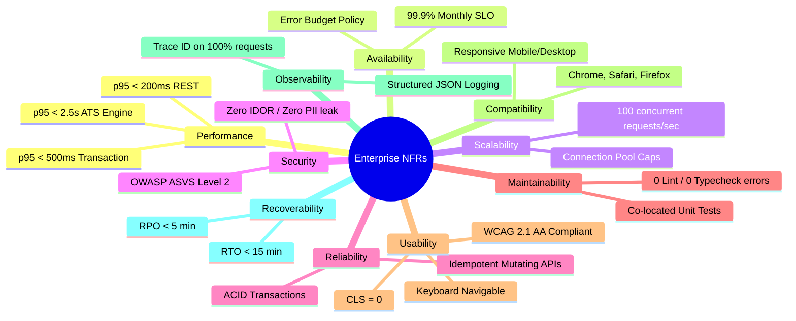

# Non-Functional Requirements & SRE Governance — ${PROJECT_NAME}

Authoritative sources: Master Framework (§16), `docs/qa/RELEASE_QUALITY_GATES.md`, `docs/qa/PERFORMANCE_TEST_STRATEGY.md`, and the ${PROJECT_NAME} Constitution (§1, §11, §12).

A software system that satisfies all functional requirements can still fail catastrophically in production if non-functional requirements (NFRs) are neglected. High response latency drives away users; unavailability destroys trust; security breaches incur legal liability; and poor recoverability causes permanent data loss.

NFR targets must be **quantifiable, realistic, aligned with business risk, and programmatically verified**.

---

## 1. The 10 Enterprise NFR Dimensions (Framework §16)

---

## 2. Quantitative NFR Targets per Dimension

| Dimension | Metric / Target | Verification Method | Statutory Gate |
|---|---|---|---|
| **Performance (REST Read)** | $p_{95} < 200\text{ms}, \; p_{99} < 400\text{ms}$ | k6 load test script (`tests/perf/`) | Gate 6 (Hardening) |
| **Performance (Transactions)**| $p_{95} < 500\text{ms}$ (credit debit, user update) | k6 load test script | Gate 6 (Hardening) |
| **Performance (Complex Engine)**| $p_{95} < 2.5\text{s}$ (17-factor ATS diagnostic engine) | Vitest benchmark & k6 | Gate 4 (SIT) & 6 |
| **Availability (SLO)** | $99.9\%$ monthly availability for core journeys | Synthetic ping & uptime monitor | Gate 8 (Production) |
| **Scalability** | Zero deadlock / zero error spike up to $100\text{ req/s}$ | k6 stress & spike scenarios | Gate 6 (Hardening) |
| **Security & Privacy** | 0 open S1/S2 vulnerabilities; UU PDP scrubbed logs | Gitleaks + `security-engineer` audit | Gate 6 (Safety) |
| **Reliability** | Zero credit overspend under 10 concurrent requests | Vitest concurrency suite | Gate 2 & Gate 4 |
| **Maintainability** | 0 ESLint errors/warnings; 0 TypeScript errors | `npm run lint && npm run typecheck` | Gate 2 (DoD) |
| **Usability & A11y** | 0 Axe violations; WCAG 2.1 AA; CLS = 0 | `@axe-core/playwright` + Lighthouse | Gate 2 & Gate 4 |
| **Compatibility** | Modern Evergreen browsers (Desktop & Mobile viewports) | Playwright multi-browser sweep | Gate 7 (RC) |
| **Observability** | `x-request-id` propagated to logs & DB queries | Telemetry audit script | Gate 8 (Production) |
| **Recoverability** | RTO $< 15\text{m}$, RPO $< 5\text{m}$; Rollback $< 30\text{s}$ | Disaster recovery simulation | Gate 7 & Gate 8 |

---

## 3. Availability, SLI/SLO & Error Budget Protocol

### 3.1 Service Level Indicator (SLI) Formulation
$$\text{SLI}_{\text{latency}} = \frac{\text{Count}(\text{Successful requests with latency } < 500\text{ms})}{\text{Total valid requests}} \ge 99.9\%$$

$$\text{SLI}_{\text{availability}} = \frac{\text{Count}(\text{HTTP status } < 500)}{\text{Total requests}} \ge 99.9\%$$

### 3.2 Error Budget Policy:
- If $> 50\%$ of the monthly error budget is burned within 7 days $\to$ **Deployment Freeze** on non-essential features; engineering shifts capacity to reliability and bug fixing.
- If $100\%$ of error budget is burned $\to$ Only hotfixes and security patches are permitted into production.

---

## 4. Recoverability Standards (RTO & RPO)

- **Recovery Time Objective (RTO):** Maximum acceptable duration from outage initiation to service restoration ($< 15\text{ minutes}$).
- **Recovery Point Objective (RPO):** Maximum acceptable data loss window during catastrophic storage failure ($< 5\text{ minutes}$, backed by PostgreSQL WAL archiving).
- **Zero-Downtime Deployment & Rollback:**
  - Automated blue-green or rolling container update.
  - Rollback script must revert application containers to previous immutable image tag in $< 30\text{seconds}$.
  - Database down-migration tested in pre-production UAT before release approval.

---

## 5. Verification Protocol

1. **Pre-Implementation:** System Analyst documents exact NFR target numbers in SRS/PRD.
2. **Implementation:** Developers construct code within resource and latency budgets (no blocking I/O, no N+1 queries).
3. **Automated Gate Verification:** k6 load tests and Lighthouse CI audits must execute and generate evidence artifacts in `docs/reports/` prior to release promotion.

