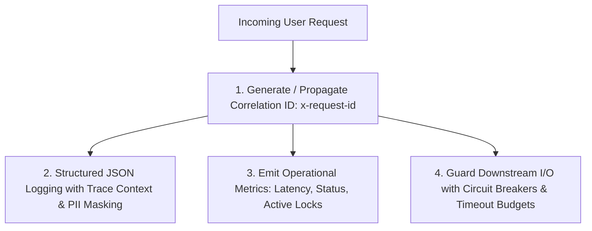

# Observability, Telemetry & Production Resilience — ${PROJECT_NAME}

Authoritative sources: `docs/process/RELEASE_GOVERNANCE.md`, `docs/qa/RELEASE_QUALITY_GATES.md` (Gate 8), the Enterprise Engineering Constitution (§11 & §12), and the Senior AI Engineering Core Rule.

A system is not production-ready merely because it runs in local development. High-level enterprise engineering demands **deep observability and intrinsic resilience**: the system must provide transparent diagnostic signals without leaking personal data, withstand external dependency degradation without cascading failures, and self-heal whenever transient faults occur.

---

## 1. The Core Observability Triad



---

## 2. Structured Logging & PII Scrubbing Standards (UU PDP Compliance)

### 2.1 Canonical Log Format
Every log entry emitted by server-side code or background workers must be structured JSON:

```json
{
  "timestamp": "2026-10-29T10:15:30.123Z",
  "level": "info",
  "traceId": "req_01h7x8...",
  "module": "billing",
  "action": "credit_deduction",
  "userId": "usr_9921",
  "durationMs": 42,
  "status": "success",
  "metadata": {
    "creditsDeducted": 1,
    "remainingBalance": 4
  }
}
```

### 2.2 Inviolable Privacy Invariant: PII Scrubbing
Under Constitution §12 and Indonesian Statutory Data Privacy (GDPR / UU PDP / CCPA per project profile), telemetry logs must **NEVER** contain:
- Raw CV text or resume markdown.
- Personal identity numbers (NIK), phone numbers, or physical addresses.
- Cleartext email addresses (use hashed identifier or omit).
- Passwords, authorization headers, bearer tokens, or session secrets.
- Payment card or bank account details.

*Violation of this invariant is an automatic Severity 1 Security Defect.*

---

## 3. Distributed Tracing & Correlation IDs

1. **Request Ingress:** Next.js middleware extracts `x-request-id` from incoming HTTP headers or generates a secure UUIDv7 trace identifier.
2. **Context Propagation:** The trace ID is attached to the asynchronous execution context (`AsyncLocalStorage`) and forwarded to:
   - All server-side database queries (as SQL query comments: `/* traceId: req_... */`).
   - All outgoing external HTTP requests (`x-request-id` header).
   - All error envelopes returned to clients (for fast support lookup without exposing stack traces).

---

## 4. Health & Readiness Probe Architecture

Production orchestrators (Docker, Kubernetes) require distinct health endpoints:

### 4.1 Liveness Probe (`GET /api/health/live`)
- **Purpose:** Verifies that the Node.js process is alive, the event loop is responsive, and memory is within bounds.
- **SLA:** Must respond with `200 OK` in $< 50\text{ms}$. Does not query external databases.

### 4.2 Readiness Probe (`GET /api/health/ready`)
- **Purpose:** Verifies that the application can currently accept and process customer traffic.
- **Checks:**
  - Database connection pool health (`SELECT 1`).
  - Active database migration version matches codebase expectation.
  - Storage adapter access verification.
- **Response:**
  - `200 OK` when all critical dependencies are operational.
  - `503 Service Unavailable` with structured dependency status when a critical dependency is down.

---

## 5. Fault-Tolerance & Resilience Patterns

### 5.1 Exponential Backoff with Full Jitter
When retrying transient network errors (e.g., external webhook, database transient connection blip), never use fixed-interval retries (which cause thundering herd spikes). Apply exponential backoff with full jitter:

$$t_{sleep} = \text{random}(0, \; \min(t_{max}, \; t_{base} \times 2^{\text{attempt}}))$$

### 5.2 Circuit Breakers for External Dependencies
Wrap all external integrations (LLM APIs, email delivery, payment providers) in circuit breakers:
- **CLOSED (Normal):** Requests pass through.
- **OPEN (Tripped):** When error rate exceeds 30% over a 1-minute window, immediately fail fast without calling the external service, returning safe fallback data.
- **HALF-OPEN (Probing):** Periodically permit 5% probe traffic to test if the external service has recovered.

### 5.3 Graceful Degradation & Fallback Defaults
If an external enhancement service (e.g. AI-powered real-time suggestion) fails, the application must gracefully degrade:
- Render basic non-AI interface components rather than crashing the entire screen.
- Inform the user politely: `"Saran AI sementara tidak tersedia; silakan lanjutkan pengeditan manual."`

---

## 6. SRE Error Budget & Alerting Thresholds

- **Availability Target:** 99.9% uptime for core user journeys (CV editing, job application).
- **Latency Budgets:**
  - $p_{95} < 200\text{ms}$ for standard REST read queries.
  - $p_{95} < 500\text{ms}$ for transactional mutations (credit deduction, account update).
  - $p_{95} < 2.5\text{s}$ for ATS diagnostic calculations.
  - SLA $< 30\text{s}$ for transactional account erasure cascade.

