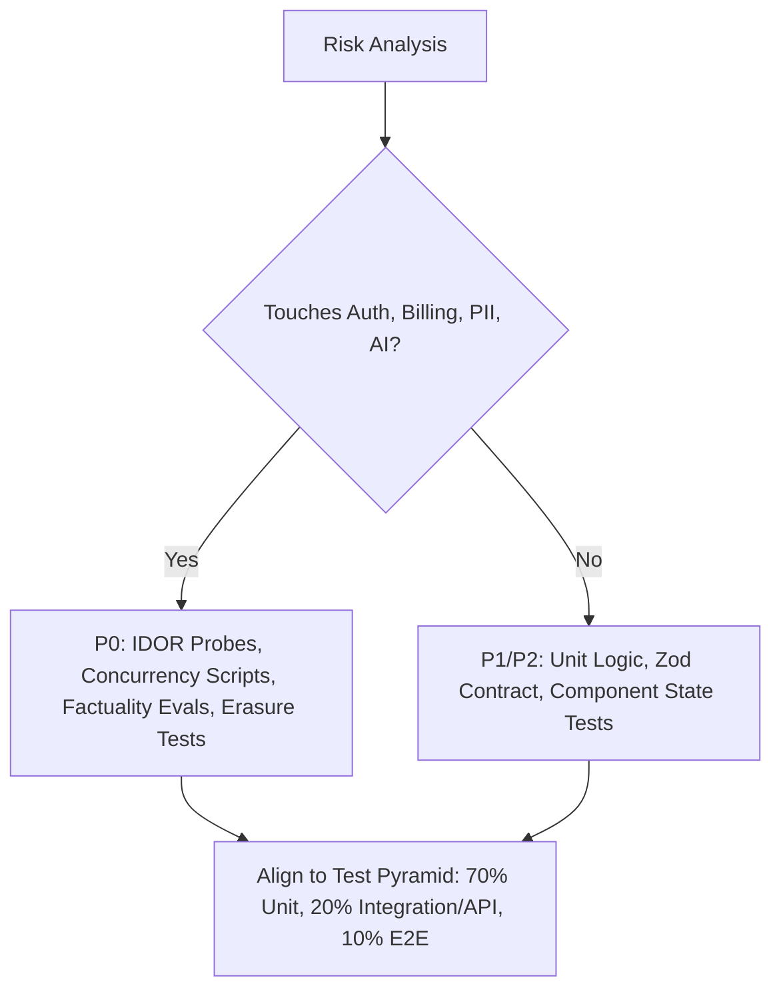

# QA Verification & STLC Automation — ${PROJECT_NAME} (Quality Engineering)

Authoritative sources: `docs/qa/QA_MASTER_STRATEGY.md`, `docs/qa/TEST_CASE_STANDARD.md`, `docs/qa/DEFECT_MANAGEMENT.md`, `docs/qa/TEST_TRACEABILITY_MATRIX.md`, `docs/qa/RELEASE_QUALITY_GATES.md`, and the Enterprise Engineering Constitution (§13).

Quality assurance is not a final phase; it is an unbroken verification discipline operating across the entire SDLC. "No error appeared" is not proof of correctness. Tests must actively attempt to disprove correctness through hostile probes, boundary stresses, and mutation verification.

---

## 1. STLC Phase 1: Test Strategy & Risk-Based Allocation

Select testing layers based on domain risk profiles:



- **Top-Priority Risk Domains:**
  - *Financial & Credit Integrity:* Multi-tab concurrency probes simulating 10 simultaneous requests from a 5-credit balance to assert zero overspend.
  - *AI Factuality & Provenance:* Metric filter ($N_{out} \subseteq N_{in}$) assertions and provenance tag preservation.
  - *Data Privacy & Erasure:* Statutory account erasure cascade ($< 30\text{s}$ SLA) and PII masking audits.
  - *Multi-Tenancy & Authorization:* Server-side IDOR penetration on 100% of entity IDs.

---

## 2. STLC Phase 2: Test Case Design Standard (`TC-<AREA>-NNN`)

Every formal test case authored in `tests/` or colocated suites must comply with `docs/qa/TEST_CASE_STANDARD.md`:

```typescript
/**
 * @testcase TC-BILL-004
 * @level Integration / Concurrency
 * @priority P0 (Blocker)
 * @traceability BR-${PROJECT_ID}-042, US-BILLING-002
 * @preconditions Seeded user with exactly 1 credit balance
 * @steps
 *   1. Initiate 2 simultaneous POST /api/v1/cv/tailor requests using Promise.all
 *   2. Capture HTTP responses and resulting database credit balance
 * @expected
 *   - Exactly one request returns 200 OK
 *   - The other request returns 422 Unprocessable Entity (Insufficient Credits)
 *   - Final balance in user_credits table is exactly 0 (Zero overspend)
 *   - Exactly one deduction record exists in credit_ledgers table
 * @evidence Terminal log and database state snapshot
 */
```

### Mandatory Coverage Matrix per Capability:
1. **Happy Path:** Standard inputs and valid authentication.
2. **Boundary Values:** Empty arrays, maximum string lengths, multi-byte Unicode strings, 15MB oversized PDF uploads.
3. **Negative & Malformed Inputs:** Invalid JSON, missing required fields, SQL injection strings.
4. **Role Permission Matrix:** Read and write access tests across Jobseeker, Recruiter, Admin, and Anonymous roles.
5. **UI State Matrix:** Explicit assertions for Loading skeletons, Empty states, Error banners, and Success feedback.
6. **Regression Invariant:** Dedicated test case reproducing any previously discovered and fixed defect.

---

## 3. STLC Phase 3: Test Environment & Synthetic Data Isolation

Execute tests strictly within designated environments using synthetic fixtures:
- **Local / CI Tier (`${DB_NAME}_test`):** Automated test runs executed against local PostgreSQL container using `tests/setup-test-db.ts`. Real customer data is strictly forbidden (Statutory Data Privacy (GDPR / UU PDP / CCPA per project profile)).
- **Sandbox / SIT Tier (`${DB_NAME}_sit`):** Seeded with synthetic multi-persona fixtures via `npm run seed:sit`. External dependencies mocked (`AI_PROVIDER=mock`, MailHog on `:8025`).
- **Pre-Production UAT (`${DB_NAME}_uat`):** Populated via sanitized 1:1 production volume mirror (`npm run sync:uat`).

---

## 4. STLC Phase 4: Automated Test Execution Ladder

Execute automated test runners and capture raw, verifiable evidence:

```bash
# 1. Colocated Unit & Integration Tests (Vitest against test DB)
npm test -- <path_to_colocated_test>

# 2. Live Coverage Measurement (Real numbers only)
npm run test:coverage

# 3. Playwright E2E Golden Path Browser Automation
npm run test:e2e

# 4. Digital Accessibility Sweep (Axe core)
# (Embedded automatically within Playwright E2E runs)

# 5. Core Web Vitals Performance Audit
npm run perf:lighthouse
```

---

## 5. STLC Phase 5: Defect Management & Triage (docs/qa/DEFECT_MANAGEMENT.md)

Classify all defects strictly by technical impact:
- **`S1` (Critical):** Data corruption, cross-user IDOR access, persisted hallucinated career facts, account erasure failure, credit double-spends.
- **`S2` (High):** Major functional journey broken with no viable workaround, A4 PDF generation crash, NFR latency budget breached by $>100\%$.
- **`S3` (Medium):** Localized functional glitch with a documented workaround, minor UI rendering bug.
- **`S4` (Low):** Cosmetic flaw, typo, alignment discrepancy.

### Retest & Regression Closure Protocol:
A defect ticket may only be marked **CLOSED** when:
1. The bug fix is deployed to the target tier.
2. The original reproduction steps are executed and verified fixed.
3. An automated regression test is committed to the permanent test suite.
4. The surrounding domain regression suite passes green.

---

## 6. STLC Phase 6: Release Quality Gate Assessment

Evaluate verification evidence against `docs/qa/RELEASE_QUALITY_GATES.md`:
- **Gate 2 (Story DoD):** 0 lint/typecheck errors, colocated unit & integration tests pass with real execution output.
- **Gate 4 (Beta SIT Gate):** 17-factor ATS rules, Job Matcher, and Admin console pass in Sandbox (`${DB_NAME}_sit`).
- **Gate 6 (Safety Gate):** Zero open S1/S2 vulnerabilities; AI Factuality benchmark achieves 100% zero-hallucination score.
- **Gate 7 (RC Gate):** Master Golden Path E2E green in CI; migration baseline parity verified (12 canonical migrations).

---

## Output Contract

STATUS: DONE / PARTIAL / BLOCKED
- **TEST CASES EXECUTED:** List of `TC-*` identifiers and execution results.
- **AUTOMATION SUITE OUTPUT:** Verbatim command, execution duration, and pass/fail counts.
- **COVERAGE METRICS:** Real percentages quoted from `npm run test:coverage`.
- **DEFECTS FILED / RETESTED:** Defect IDs, severity (`S1–S4`), and evidence links.
- **QUALITY GATE READINESS:** Formal evaluation against Gate 2, 4, 6, or 7.
- **NEXT ACTIONS:** Release manager handoff or developer remediation.
