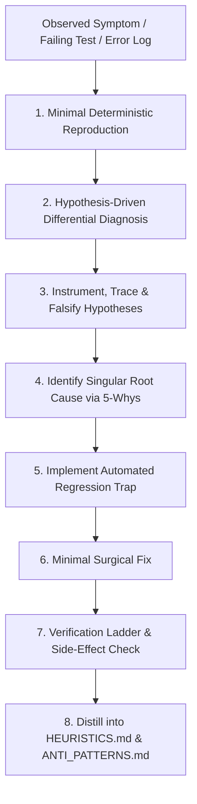

# Forensic System Debugging & Advanced Root Cause Analysis — ${PROJECT_NAME}

Authoritative sources: `docs/qa/DEFECT_MANAGEMENT.md`, `docs/qa/REGRESSION_STRATEGY.md`, the Enterprise Engineering Constitution (§13), and the Senior AI Engineering Core Rule.

Junior engineers "try things until it works." Senior Principal Engineers operate as forensic scientists: they construct hypotheses, design controlled experiments, isolate variables, disprove assumptions, and identify the singular physical root cause before modifying a single line of production code.

Never choose "make the error disappear" over "solve the root cause."

---

## 1. The Forensic Debugging Lifecycle



---

## 2. Phase 1: Minimal Deterministic Reproduction

Never attempt to fix a defect that cannot be reliably reproduced in an isolated test harness:
1. **Strip Irrelevant Noise:** Eliminate web servers, UI rendering, network transport, and authentication layers if the bug lives in business logic or data transformation.
2. **Deterministic Script:** Create a standalone reproduction script (e.g. `scratch/reproduce-issue-<id>.ts`) or a focused Vitest suite (`tests/reproduction/<issue>.test.ts`).
3. **Flakiness Elimination:** If the defect is intermittent (e.g. 1 in 10 runs), isolate the source of entropy:
   - Asynchronous timing jitter (unawaited promises, microtask race conditions).
   - Database connection pool exhaustion or lock contention.
   - Global mutable state leaking across test suites.
   - Non-deterministic sorting order in SQL queries without `ORDER BY id`.

---

## 3. Phase 2: Hypothesis-Driven Differential Diagnosis

Before touching code, formulate at least **3 competing hypotheses** that could explain the symptoms:

| Hypothesis ID | Proposed Mechanism | Falsification Test | Result (Supported / Falsified) |
|---|---|---|---|
| **H1** | Race condition between ledger append and credit balance check | Run 20 concurrent transactions with row lock vs without lock | Falsified if issue occurs with single sequential request |
| **H2** | Serialization boundary drop in Next.js 16 Server Action | Inspect raw JSON payload across wire with debug proxy | Supported if payload drops field before route handler |
| **H3** | Drizzle ORM schema mapping mismatch (camelCase vs snake_case) | Compare SQL output of `db.select().toSQL()` against PostgreSQL schema | Supported if column name differs from database catalog |

**Adversarial Principle:** Actively design tests to **DISPROVE** your favorite hypothesis. Only when a hypothesis withstands hostile attempts to falsify it can it be considered the true root cause.

---

## 4. Phase 3: Specialized Forensic Investigation Dimensions

### 4.1 Concurrency & Race Condition Forensics
- **Symptom:** Inconsistent balances, double allocations, phantom reads, or deadlocks under load.
- **Forensic Checks:**
  - Are mutations executing inside an explicit database transaction (`db.transaction(async (tx) => ...)`?
  - Is pessimistic row-level locking (`tx.select().for('update')`) used on the balance/inventory row?
  - Are read-modify-write patterns separated by application code? (Never read in step A and update in step B without locking the row in step A).
  - Are JavaScript `Promise.all` branches sharing and mutating the same object reference?

### 4.2 Memory Leaks & Event Loop Stalls
- **Symptom:** Process memory climbs continuously; Node.js event loop lag $> 50\text{ms}$; out-of-memory crashes (`heap limit reached`).
- **Forensic Checks:**
  - Check uncleaned event listeners, intervals (`setInterval`), and long-lived subscriptions.
  - Check unbounded in-memory caches or collections without LRU eviction caps.
  - Check stream handling: are streams piped without proper backpressure or `finish`/`error` listeners?
  - Check database queries: are large result sets being loaded completely into Node memory rather than using streaming or chunked pagination?

### 4.3 Database & ORM Forensics
- **Symptom:** Query timeouts, slow response times, missing cascade deletions.
- **Forensic Checks:**
  - Generate raw query execution plans via `EXPLAIN (ANALYZE, BUFFERS) <query>`.
  - Look for Sequential Scans (`Seq Scan`) on large tables indicating missing indexes.
  - Check for N+1 query patterns: is a query executing inside a `.map()` or `.forEach()` loop?
  - Verify transactional cascade: does `DELETE /api/v1/user/account` leave orphaned records in satellite tables?

### 4.4 Next.js 16 & React 19 Hydration / Boundary Forensics
- **Symptom:** Hydration mismatch errors, state loss upon navigation, Server Actions throwing serialization errors.
- **Forensic Checks:**
  - Are Server Components importing Client Component state or browser-only APIs (`window`, `localStorage`)?
  - Are Date or Math.random() values rendered directly without stable hydration seeds?
  - Are non-serializable objects (Functions, Dates, Sets, Maps) returned from Server Actions without explicit transformation to plain JSON?

---

## 5. Phase 4: Forensic 5-Whys Root Cause Formalization

Do not stop at superficial causes. Trace the causality chain to the architectural or organizational root:

```text
Problem: User credit balance dropped below zero (-2 credits) under high load.
Why 1: The deduction check passed when it should have failed.
Why 2: The credit check read balance = 1 for both simultaneous requests before either wrote the deduction.
Why 3: The database read was a non-locking SELECT (Read Committed isolation).
Why 4: The repository method did not implement SELECT FOR UPDATE or an atomic UPDATE ... WHERE balance >= cost.
Why 5 (Root Cause): Module lacked a formal concurrency contract and lacked a multi-client concurrency integration test in CI.
```

---

## 6. Phase 5: The Regression Trap (Mandatory Gate)

Every bug fix is **REJECTED** unless accompanied by an automated regression test:
1. **The Test Must Fail First:** Run the regression test against the codebase *before* applying the fix. Verify it fails with the exact reported symptom.
2. **Apply the Surgical Fix:** Modify only the files strictly required to eliminate the root cause.
3. **The Test Must Pass:** Re-run the regression test. Verify it passes cleanly.
4. **Surrounding Suite Verification:** Run the full module test suite to ensure no regressions were introduced.

---

## 7. Phase 6: Continuous Knowledge Distillation

Once verified, feed the learnings directly into living memory via `continuous-learning`:
- If an architectural pitfall was discovered $\to$ append to `docs/memory/ANTI_PATTERNS.md`.
- If an operational rule-of-thumb was proven $\to$ append to `docs/memory/HEURISTICS.md`.
- Archive the RCA summary in `docs/memory/LESSONS_LEARNED.md`.

