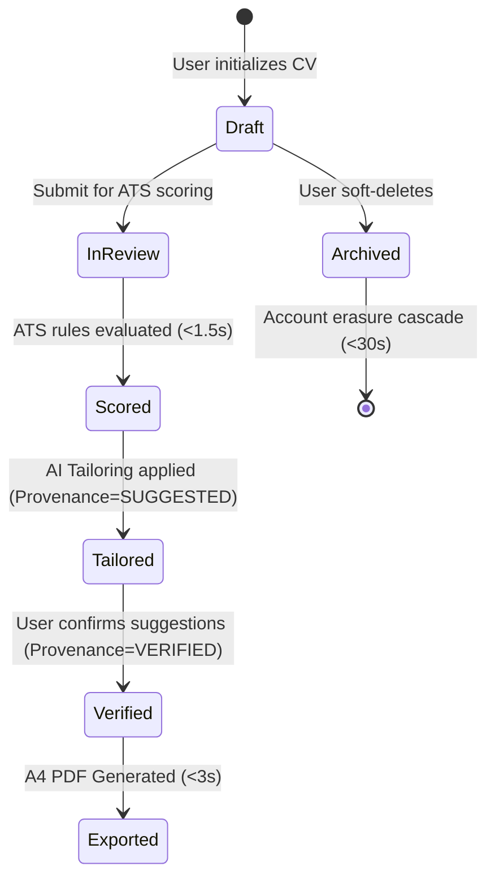
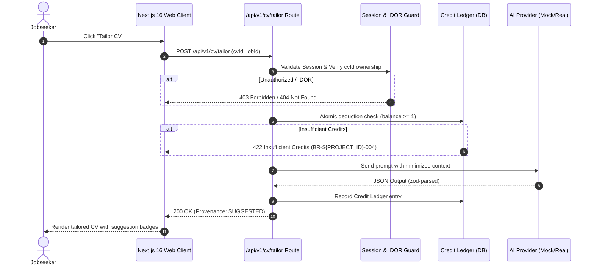

# System Modeling & Technical Specification — ${PROJECT_NAME} (SDLC Phase 2)

Authoritative sources: `docs/process/SDLC.md`, `docs/design/`, `docs/api/`, `docs/data/`, and `docs/qa/RELEASE_QUALITY_GATES.md` (Gate 1: Story DoR).

System modeling eliminates developer guesswork and ambiguity. Before any implementation begins, the system's states, boundaries, failure modes, and interaction contracts must be formally specified.

---

## 1. Mermaid State Machine Modeling

For any workflow with lifecycles (e.g. CV drafts, job applications, interview sessions, credit transactions), model the explicit state transitions:



### State Machine Rules:
1. **Explicit Invalid Transitions:** Specify what happens when an invalid transition is attempted (e.g. attempting to tailor an archived CV returns HTTP 422 with `INVALID_STATE_TRANSITION`).
2. **Terminal States:** Clearly identify final states (`Deleted`, `Archived`, `Expired`) where mutations are prohibited.

---

## 2. Sequence Diagram Modeling

Model cross-module and cross-tier chronological interactions:



---

## 3. Boundary Value & Edge-Case Matrix

Construct explicit boundary matrices covering:

| Dimension | Minimum / Empty Boundary | Nominal / Typical | Maximum / Stress Boundary | Invalid / Hostile Input |
|---|---|---|---|---|
| **Text Inputs** | `""` (empty string) | 10–200 characters | Exact max limit (e.g. 5000 chars) | 100k chars, SQL payloads, `<script>` |
| **CV Uploads** | 0 bytes (empty file) | 1–3 MB PDF/DOCX | 10 MB strict ceiling | Executable (.exe), corrupted PDF, zip bomb |
| **Credit Ledger** | 0 credits remaining | 5–20 credits | 10,000 credits | Negative integers (`-5`), float credits (`1.5`) |
| **Concurrency** | 1 single request | 2 concurrent requests | 10 concurrent requests | 100 simultaneous requests / same session |

---

## 4. Error Catalog Standardization

Every endpoint must have a documented error catalog mapping business failure states to standard HTTP response envelopes:

```json
{
  "error": {
    "code": "INSUFFICIENT_CREDITS",
    "message": "Saldo kredit Anda tidak mencukupi untuk melakukan tailoring CV.",
    "details": {
      "required": 1,
      "current": 0
    }
  }
}
```

- `400 BAD_REQUEST`: Zod parsing failure on request body, invalid JSON syntax.
- `401 UNAUTHORIZED`: Missing or expired session cookie.
- `403 FORBIDDEN`: Authenticated user lacks required role (e.g. jobseeker accessing recruiter dashboard).
- `404 NOT_FOUND`: Resource does not exist or user does not own it (IDOR protection without existence leakage).
- `422 UNPROCESSABLE_ENTITY`: Business rule violation (e.g. BR-${PROJECT_ID}-006 NIK input, insufficient credits, invalid state transition).
- `429 TOO_MANY_REQUESTS`: Rate limit threshold exceeded on sensitive endpoints.
- `500 INTERNAL_SERVER_ERROR`: Sanitized generic error envelope (details written exclusively to internal server logs).

---

## 5. Zod Contract Interface Specifications

Model request and response schemas strictly with Zod:

```typescript
import { z } from 'zod';

export const TailorCvRequestSchema = z.object({
  cvId: z.string().uuid(),
  jobId: z.string().uuid(),
  targetFocus: z.enum(['GENERAL', 'SKILLS_MATCH', 'EXECUTIVE']).default('GENERAL'),
}).strict(); // Enforce strict mode to prevent mass assignment

export const TailorCvResponseSchema = z.object({
  tailoredSectionId: z.string().uuid(),
  suggestedContent: z.string().min(1),
  provenance: z.literal('SUGGESTED'),
  creditsDeducted: z.number().int().positive(),
  remainingBalance: z.number().int().nonnegative(),
});
```

---

## 6. Gate 1 (DoR) Sign-Off Checklist

Before releasing a specification to development, verify:
- [ ] State transitions and terminal states formally diagrammed.
- [ ] Sequence diagram covers authentication, IDOR checks, and transaction boundaries.
- [ ] Boundary value matrix defines behavior for 0, nominal, max, and hostile inputs.
- [ ] Error catalog enumerates all non-200 HTTP responses.
- [ ] Zod schemas enforce strictness and eliminate mass assignment risks.
- [ ] All business rules are assigned immutable `BR-${PROJECT_ID}-NNN` identifiers.

---

## Output Contract

STATUS: READY_FOR_DEV / SPECIFICATION_INCOMPLETE / BLOCKED
- **SYSTEM MODEL ARTIFACTS:** State diagrams and sequence flows.
- **BOUNDARY MATRICES:** Tabular boundary specifications.
- **CONTRACT SCHEMAS:** Zod request and response interfaces.
- **ERROR CATALOG:** Error code mappings and localized messages.
- **GATE 1 STATUS:** Readiness assessment against Gate 1 criteria.
