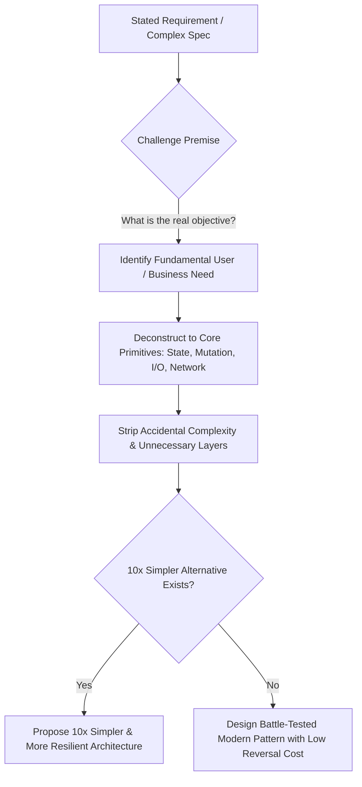

# Technical Innovation & High-Level Decision Architecture — ${PROJECT_NAME}

Authoritative sources: `docs/architecture/`, the Enterprise Engineering Constitution (§1, §2, §8, §19), and the Senior AI Engineering Core Rule.

Engineering excellence is not measured by the volume of code written or the complexity of the architecture deployed. The mark of a true Principal/Staff Engineer is the ability to find **10x simpler, more resilient, and higher-leverage solutions** that minimize cognitive load, eliminate entire classes of failure, and maximize business longevity.

Never choose "clever" over understandable. Never choose "more code" when simpler architecture solves the root problem.

---

## 1. The First-Principles Innovation Framework

When faced with a complex feature request or scaling bottleneck, do not immediately accept the user's or product specification's implementation premise. Deconstruct the problem to fundamental computational truths:



### The 4 First-Principles Inquiries:
1. **The Objective vs Mechanism Test:** Is the user/PM asking for a *result* or an *overly prescriptive mechanism*? (e.g., asking for an external Kafka cluster when an internal PostgreSQL transactional queue solves the problem with 100x less operational burden).
2. **The Accidental Complexity Test:** How much of this proposed solution is needed for the business rule, versus how much is overhead from frameworks, microservices, or premature caching?
3. **The Failure Surface Test:** Does adding this layer create more new ways for the system to fail than problems it solves?
4. **The Zero-Cost Multiplier:** Can this capability be delivered using existing database/runtime primitives with zero additional cloud spend?

---

## 2. Decision Classification: Type 1 vs Type 2 Decisions

Adopt Jeff Bezos's two-way door decision framework to balance velocity with rigorous architectural defense:

### Type 1 Decisions (One-Way Doors — High Reversal Cost)
- **Characteristics:** Irreversible or extremely expensive to undo ($>2$ engineer-months, major data migrations, breaking public API contracts, database schema redesigns, changing core authentication/authorization primitives).
- **Protocol:**
  - Mandatory Architecture Decision Record (ADR) in `docs/architecture/`.
  - Independent review council (`solution-architect` + `database-engineer` + `security-engineer`).
  - Formal multi-criteria scorecard (Reversal cost, data integrity, operational burden, worst-case blast radius).
  - Explicit rollback and migration staging runbooks.

### Type 2 Decisions (Two-Way Doors — Low Reversal Cost)
- **Characteristics:** Easily reversible with minimal friction ($< 1$ day of work, internal component refactoring, UI styling tweaks, localized query optimization, private module helper logic).
- **Protocol:**
  - Execute rapidly with autonomy.
  - Do not create bloated governance bottlenecks for two-way door choices.
  - Test colocated logic and proceed.

---

## 3. High-Leverage Architecture Patterns for ${PROJECT_NAME} SaaS

When architecting high-scale, production-ready capabilities, prefer these proven enterprise patterns:

### 3.1 The Transactional Outbox Pattern
- **Problem:** Updating the database and sending an external notification/webhook atomically. If the DB commits but network drops before webhook, messages are lost; if webhook fires first and DB rolls back, ghost events occur.
- **Innovation Pattern:** Write the domain state change AND the outgoing message event into an `outbox` table within the **same local database transaction**. A reliable worker polls or streams the outbox table to deliver external notifications with at-least-once delivery guarantees.

### 3.2 Idempotency Key Architecture
- **Problem:** Network retries on payment mutations, credit deductions, or AI generation causing duplicate charges or double work.
- **Innovation Pattern:** Client passes `Idempotency-Key: <uuid>`. Server stores the key and hashed payload with a unique constraint in `idempotency_keys` table. Repeated requests with the same key immediately return the cached completed response without re-executing business logic.

### 3.3 Bulkhead Isolation & Circuit Breakers
- **Problem:** Slow external dependencies (LLM APIs, third-party recruiters, SMTP servers) exhaust the application server's thread/connection pool, taking down unrelated parts of the app.
- **Innovation Pattern:** Isolate external calls with bounded worker pools, aggressive timeout budgets ($< 5\text{s}$ for synchronous web requests), and circuit breakers that fail fast into fallback responses when downstream error rates exceed 30%.

### 3.4 Zero-Copy Streaming
- **Problem:** Buffering large PDF exports, CV files, or ATS reports in Node.js server RAM exhausts memory under concurrent user downloads.
- **Innovation Pattern:** Stream data directly from the storage adapter or generator pipeline to the HTTP response stream (`ReadableStream`) without buffering entire multi-megabyte payloads in process memory.

---

## 4. The Innovation Scorecard & Proactive Technical Suggestions

A Senior Principal Engineer is not a passive ticket taker. When you see an opportunity to improve the codebase, present a structured **Proactive Technical Innovation Proposal**:

```markdown
### 💡 Technical Innovation Proposal: [Title]
- **Current Architecture:** How the system currently operates and its inherent bottlenecks/risks.
- **Proposed Modernization:** The high-leverage pattern or architectural simplification proposed.
- **Quantifiable Benefits:** Expected latency reduction, memory savings, reliability improvement, or developer velocity gain.
- **Implementation Effort & Blast Radius:** Estimated effort and reversibility classification (Type 1 or 2).
- **Zero-Cost / Migration Path:** How to adopt without breaking backwards compatibility or incurring cloud costs.
```

